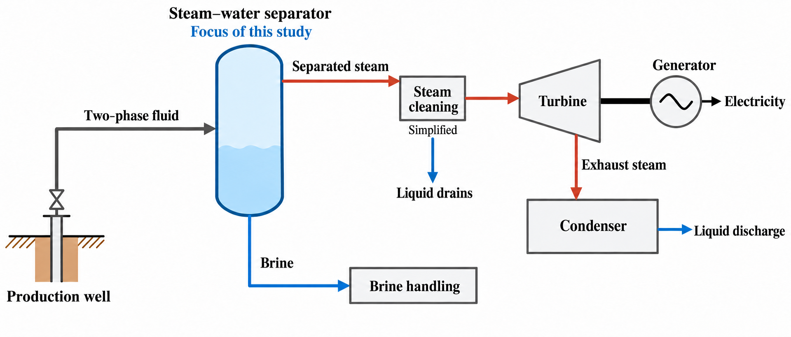
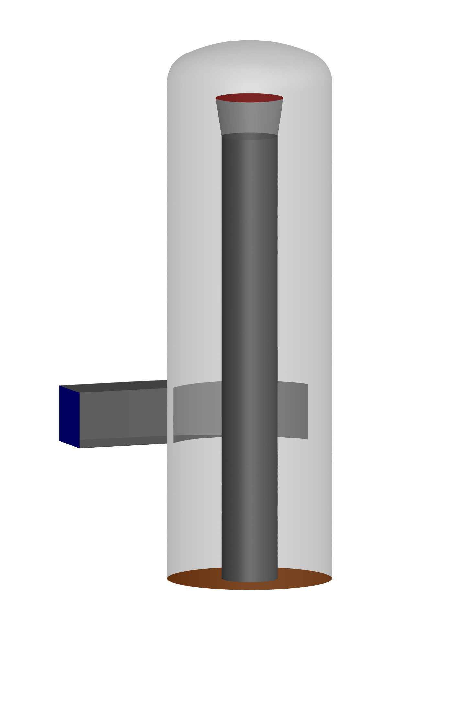
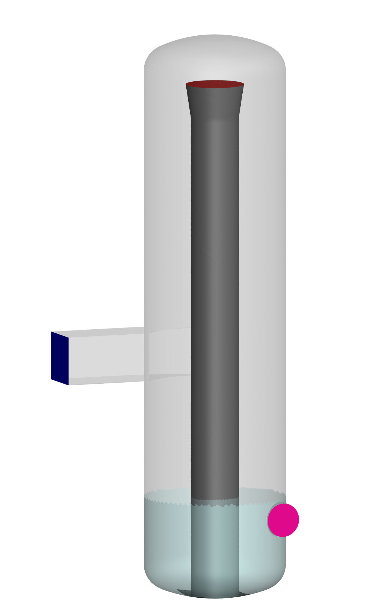
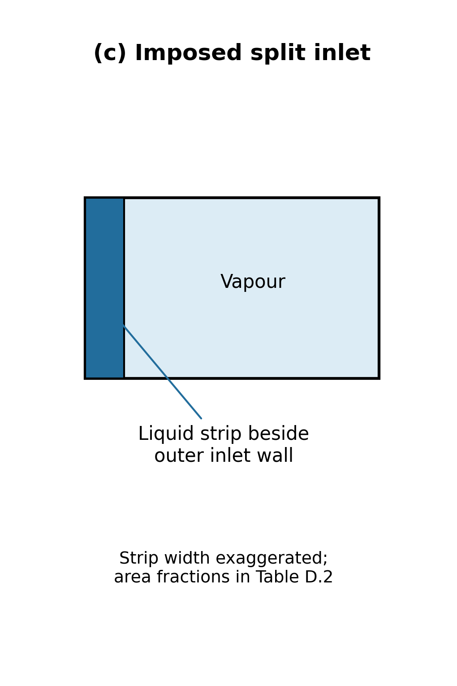
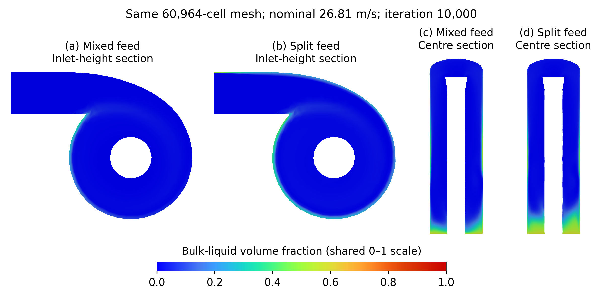
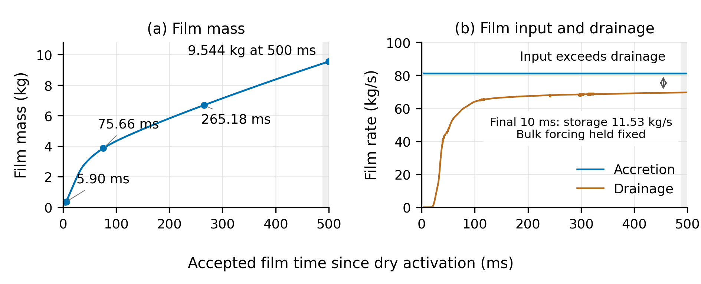
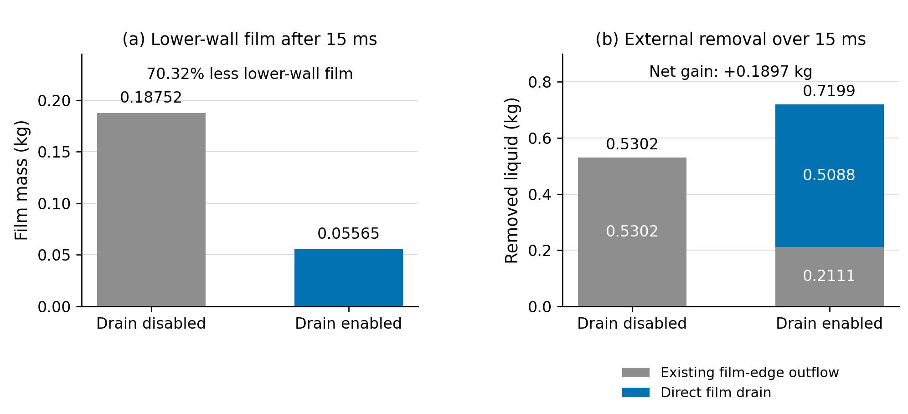
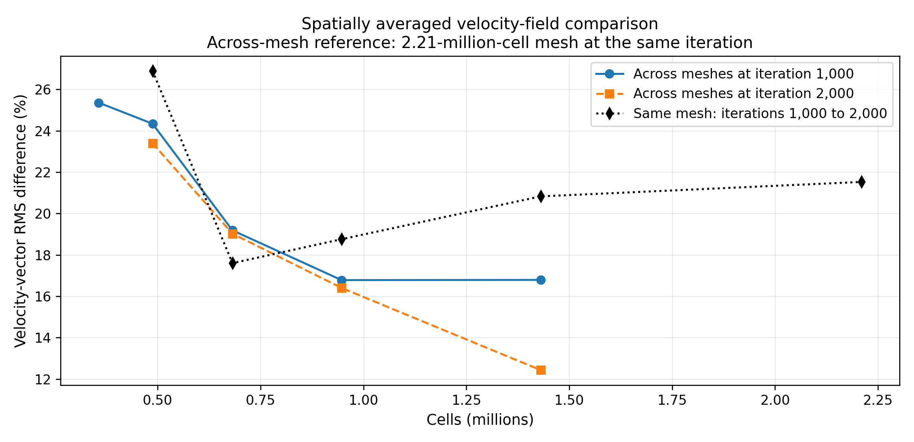
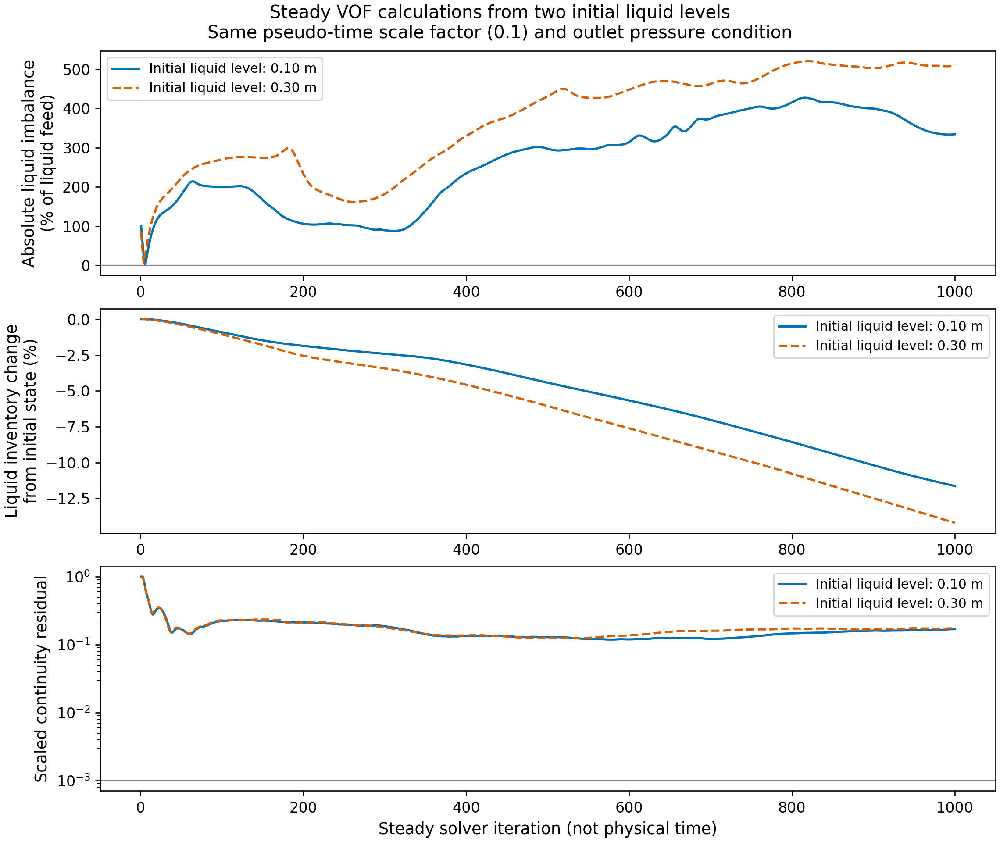

# Geothermal steam-water separator design CFD modelling and optimising

## Title page information

| Field | Information |
| --- | --- |
| Author | Andy Tran |
| Co-worker | Shuhei Yokkaichi |
| Supervisors | Sadiq Zarrouk and Maedeh Amirpour |
| Institution | The University of Auckland |
| Report | Part IV Research Project Report |
| UPI | qtra338 |
| Date | 18 October 2026 |

## Abstract

This project developed and tested an inherited computational fluid dynamics model to investigate two-phase inlet conditions in a geothermal steam–water separator. Separate liquid and vapour inlet regions made the prescribed distribution explicit. Numerical collection, staged loading and wall-film modelling extended the model to examine where liquid accumulated and how it could reach removal. These developments addressed continuing inventory and pressure changes identified during baseline mesh assessment.

On the same mesh and at matched 10,000-iteration endpoints, the imposed stratified inlet retained about 37% more liquid than the mixed inlet and produced clearer wall and base enrichment. Both still sent nearly all incoming bulk liquid through the steam outlet, so the result established sensitivity of liquid distribution rather than improved separation. Low-feed preparation, inlet ramping and Coupled pressure–velocity treatment supplied starting fields for wall studies, with continuity residuals of approximately 0.002–0.005 at full feed. The reported full-feed state retained excess liquid removal equivalent to 20.81% of liquid feed.

Wall-film calculations made surface transport, storage and drainage separately observable. Selected windows passed local balance checks with the bulk equations active. A matched direct-drain test reduced the lower-wall store by 70.32%, but total film by only 1.70% relative to the undrained case. Local drainage therefore did not control the whole film inventory. Explicit brine-outlet studies added component and short-duration checks, without establishing sustained operating drainage.

Mesh and particle tests identified which predictions remained sensitive to numerical choices. At 195 ms, the finest of four completed frozen-bulk mesh states had about 30% less film and 32% less instantaneous drainage than the next coarser mesh. Differences in preparation and held bulk fields prevented an isolated mesh-error estimate. Reconstructed efficiency estimates agreed with earlier project estimates within 0.019 percentage points when unfinished tracks were counted as separated, although 16.78–33.29% of injected particle mass had no resolved final destination. A tenfold increase in tracking allowance more than doubled the small escaped-mass estimate.

The contribution is a set of tested modelling capabilities and evidence linking inlet distribution, liquid storage and removal. A complete, stationary, mesh-independent and physically validated separator solution was not established. The findings define the liquid accounting, particle-fate and geometry checks still needed before using the model for performance optimisation.

## Declaration

**Student:** Andy Tran (qtra338)

I hereby declare that:

1.  This report is the result of the final year project work carried out by my project partner (see cover page) and I under the guidance of our supervisor (see cover page) in the 2026 academic year at the Department Engineering Science and Biomedical Engineering, Faculty of Engineering, University of Auckland.

2.  This report is not the outcome of work done previously.

3.  This report is not the outcome of work done in collaboration, except that with a potential project sponsor (if any) as stated in the text.

4.  This report is not the same as any report, thesis, conference article or journal paper, or any other publication or unpublished work in any format.

**Statement of contribution and prior work.** The starting point was the separator CFD model supplied by Hananto Purnanto from the work reported by Purnanto et al. (2013). During the 2026 project, this model was reconstructed and assessed, and extended through split-inlet modelling, numerical liquid collection, staged loading, wall-film transport and drainage treatments, and explicit brine-outlet investigations. Mesh and particle-tracking assessments examined the limits of the resulting predictions. This report presents these developments and findings from the joint project with Shuhei Yokkaichi. Reproduced or adapted figures identify their sources in their captions.

**Use of generative AI.** OpenAI Codex assisted with coding, evidence analysis and report drafting.

**Prior report material.** The literature review reuses material from the author’s first report for this project, with subsequent revisions.

**Word count:** 11,289 words from Introduction through Future Work, including headings, captions and tables.

**Signature:** Andy Tran

**Date:** 18 October 2026

## Table of contents

1. Introduction
2. Literature review
3. Model and methods
4. Verification and validation assessment
5. Results
6. Discussion
7. Conclusions and future work
8. References
9. Appendices

Appendices A–E retain the evidence register, numerical checks, unresolved evidence, model definitions and historical particle inputs. Appendix F gives the explicit brine-outlet investigation; Appendix G gives supporting development and sensitivity results.

The LaTeX edition generates the table of contents and page references automatically.

## Acknowledgements

I would like to thank my supervisors, Sadiq Zarrouk and Maedeh Amirpour, for their guidance, advice and feedback throughout this project.

I also thank my project partner, Shuhei Yokkaichi, for his collaboration, shared work and discussions throughout the year.

I am grateful to Hananto Purnanto for providing the separator CFD model that formed the starting point for this project.

## Glossary of terms and symbols

| **Term** | **Meaning** |
|:---|:---|
| BOC | Bottom-outlet cyclone separator |
| CFD | Computational fluid dynamics |
| DPM | Discrete Phase Model (droplet tracking) |
| EWF | Eulerian Wall Film (surface liquid transport) |
| RANS | Reynolds-averaged Navier–Stokes equations |
| RNG | Renormalisation group (turbulence model) |
| VOF | Volume of Fluid (interface model) |
| Carrier field | Bulk flow used for droplet tracking |
| Active bulk | Bulk flow equations continue to update |
| Frozen bulk | Bulk fields held fixed while other models advance |
| Film accretion | Liquid transferred into the wall-film model |
| Incomplete trajectory | Particle track without a resolved final destination |
| Collector | Numerical region that removes liquid through a source |
| Stationary inventory | Retained liquid mass within stated change limits |
| Numerical acceptance | Meeting the stated checks for an individual test and observation window |
| Liquid inventory | Liquid mass retained within the vessel or wall film |
| Residual | Scaled measure of how well a discretised equation is satisfied |
| Outlet dryness (outlet steam quality) | Vapour mass fraction in flow through the steam outlet |
| Sink | Negative source term used to remove mass numerically |
| Film age | Time accumulated by the film equations; not necessarily physical elapsed time of the whole flow |
| Inner film iterations | Iterations used to solve the film equations within one film timestep |
| RMS | Root-mean-square measure used here for spatial velocity differences |
| Validation | Assessment against physical evidence for an intended use |

### Symbols 

|  |  |
|:---|:---|
| $\alpha_L$ | Liquid volume fraction |
| $\rho_L$ | Liquid density (kg/m$^{3}$) |
| $\dot m$ | Mass flow rate (kg/s) |
| $M_L$ | Retained liquid mass (kg) |
| $M_f$ | Retained wall-film mass (kg) |
| $R_L$ | Signed liquid balance remainder (kg/s) |
| $S_L$ | Liquid mass source per unit volume (kg/(m$^{3}$·s)) |
| $\tau$ | Collector depletion time (s) |
| $K$ | Dimensionless outlet-resistance coefficient |
| $\eta_{\mathrm{assumed}}$ | Efficiency estimate assuming incomplete particles are separated (%) |

# Part 1 — Introduction and literature review

## 1. Introduction

In a flash-steam geothermal power system, fluid from production wells supplies a steam–water separator before electricity is generated. Figure 1 shows the separator between the production well and the turbine: separated steam passes through downstream cleaning equipment before driving the turbine–generator, while brine leaves through a separate liquid-handling route (Arifien and Zarrouk, 2015). The separator therefore links the geothermal fluid supply to the steam used for power generation.

*Figure 1. Steam–water separator in a single-flash geothermal system, showing the separate steam and brine routes. Adapted from Arifien and Zarrouk (2015, Figure 1).*

Geothermal steam–water separators remove liquid from the steam supplied to turbines. Liquid carryover can contribute to erosion and mineral deposition, so reliable separation is important for plant operation. Established design methods support separator sizing and performance estimates, while computational fluid dynamics (CFD) provides access to internal flow fields that are difficult to measure. These complementary roles are described by [Zarrouk and Purnanto (2015)](https://www.sciencedirect.com/science/article/abs/pii/S0375650514000637).

The primary focus of this project is the effect of two-phase inlet conditions on geothermal separator performance. This work builds on the geothermal separator CFD study by Purnanto et al. (2013), whose Fluent model provides the starting point for the investigation. That model assumes a mist inlet condition, with gas as the continuous phase and liquid as a dispersed phase. In practice, inlet flow conditions depend on fluid enthalpy, mass flow rate and upstream pipe geometry, which influence the liquid distribution and droplet structure entering the separator. These differences can affect the internal flow field, pressure distribution and separation efficiency. This project investigates an imposed stratified inlet arrangement, with liquid occupying the outer-wall side of the inlet and steam occupying the remaining area.

To this end, the project had four objectives. The first was to become familiar with and reproduce the results of the existing Purnanto et al. (2013) Fluent model, with the aim of establishing a validated baseline. The second was to expand the model by implementing realistic two-phase inlet conditions across a range of flow regimes. The third was to investigate how inlet flow regime affects the internal flow field, pressure distribution and separation efficiency across a range of operating conditions. The fourth was to identify the geometric or operational parameters that most strongly influence separation efficiency, providing guidance for separator optimisation.

During the mesh-convergence study of the reconstructed Purnanto et al. (2013) model, liquid inventory and pressure drop continued to change with iteration. These observations prompted closer examination of how the model accounted for separated liquid. The published model excluded brine outflow and assumed a constant water level, with the lower vessel and brine outlet outside its computational domain. The inherited computational setup consequently had no dedicated discharge boundary for collected brine.

Without a brine-removal path, steady mass balance would require all incoming liquid to leave through the steam outlet, which is inconsistent with the intended separation process. Addressing liquid removal and numerical convergence therefore became necessary before the effects of inlet conditions could be interpreted reliably. This formed an unexpected substantial part of the project, involving tests of numerical liquid collectors and resolved brine-outlet treatments to assess whether they could support a mass-conserving solution that remained stable with further iteration.

The study covers the separator vessel and its inlet conditions, with emphasis on model reconstruction, liquid removal and numerical assessment. Downstream steam pipelines, condensate drain pots, scrubbers and demisters are outside its scope. Related simplified-domain investigations are discussed with attribution and with regard to differences in geometry and modelling choices.

The literature review establishes the physical and modelling context. The methods and verification sections explain how the calculations were performed and assessed. The results and discussion then examine their implications for the project objectives, followed by conclusions and recommendations for future work.

## 2. Literature Review

Geothermal steam-water separation is a well-established but technically complex process that sits at the heart of liquid-dominated geothermal power generation. This review examines the existing body of knowledge across four themes relevant to this project. First, the design and performance of geothermal steam-water separators are discussed, covering separator types, sizing methods, and the key metrics by which performance is evaluated. Second, the two-phase flow physics governing separation behaviour inside the vessel are examined, with particular attention to the mechanisms that cause actual separator efficiency to fall short of theoretical predictions. Third, the application of computational fluid dynamics (CFD) as a tool for modelling separator behaviour is reviewed, tracing the development of prior Fluent-based models and identifying their limitations. Finally, the broader system context is considered, examining how downstream factors beyond the separator itself influence the quality of steam ultimately delivered to the turbine. Together, these themes establish the state of current knowledge and define the research gap that this project addresses.

### 2.1. Geothermal Steam-Water Separator Design and Performance

Most conventional geothermal resources are liquid-dominated, meaning fluid extracted from the reservoir arrives at the surface as a two-phase mixture of steam and hot brine. Before this fluid can drive a turbine, the phases must be separated, as liquid droplets entering the turbine cause blade erosion, scale deposition, and long-term efficiency losses (Rizaldy et al., 2016). The steam-water separator is therefore one of the most critical pieces of equipment in a geothermal power plant.

Since the development of the first liquid-dominated reservoir at Wairakei, New Zealand in the 1950s, two designs have dominated the industry: the vertical cyclone separator and the horizontal gravity separator. Approximately 70% of plants worldwide use vertical separators, with vertical designs common in fields influenced by New Zealand technology and horizontal designs more prevalent in Iceland, Japan, and Russia (Zarrouk & Purnanto, 2014).

The vertical Bottom Outlet Cyclone (BOC) separator operates by introducing the two-phase fluid tangentially into a cylindrical vessel, inducing a spiralling flow. Centrifugal force drives the denser liquid phase to the vessel wall where it falls to the brine outlet, while the lower-density steam migrates to the central axis and exits through an internal steam pipe at the bottom of the vessel, as illustrated in Figure 2. The BOC design with a spiral inlet is currently the industry standard, having evolved from the original circular inlet design of Bangma (1961), and the rectangular inlet of Lazalde-Crabtree (1984), as reviewed in Zarrouk & Purnanto (2014). The horizontal separator, by contrast, relies on gravity settling and is simpler to contruct but requires a larger vessel for the same flow rate and achieves lower separation efficiency under equivalent conditions.

*Figure 2. Flow through a vertical BOC separator, showing tangential entry, swirling flow and liquid film on the vessel wall. Adapted from Rizaldy et al. (2016).*

Separator sizing is primarily governed by the fluid enthalpy, total mass flow rate, and chosen separation pressure. Separation pressure is selected to maximise power output while minimising silica scaling (Zarrouk & Purnanto, 2014). BOC separator performance is typically expressed through separation efficiency, with design calculations predicting values in the range of 99.5–99.99% when inlet velocities are maintained between 30-40 m/s, below the breakdown velocity at which re-entrainment degrades separation. Outlet steam quality (dryness) is the vapour mass fraction of the flow leaving through the steam outlet (Purnanto et al., 2013). Internal pressure drop is also an important metric, as losses within the vessel directly reduce the energy available to the turbine.

Finally, separator location relative to the power station significantly affects the dryness of steam delivered to the turbine. Centralised separation stations reduce capital cost but increase the risk of carryover reaching the turbine. A minimum separation distance of approximately 400 m from the power station is generally recommended to allow adequate steam scrubbing (Zarrouk & Purnanto, 2014).

### 2.2. Two-Phase Flow Physics Inside the Separator

Understanding what actually happens to the two-phase fluid inside the separator is essential for predicting separation performance. The inlet flow is not simply a uniform steam-water mixture, depending on fluid enthalpy, mass flow rate, and pipe geometry, the incoming fluid can exhibit a range of flow regimes including annular, slug, or dispersed flow, each with different liquid distributions and droplet characteristics (Zarrouk & Purnanto, 2014). The flow regime at the inlet directly influences the size and distribution of liquid droplets entering the vessel, which in turn governs how effectively they can be separated by centrifugal force.

Once inside the BOC separator, the spiralling flow field causes denser liquid droplets to migrate outward toward the vessel wall under centrifugal action. Most of this liquid successfully drains down the wall to the brine outlet. However, a proportion of the separated liquid forms a thin continuous film on the inner wall of the vessel. As shown in Figure 2, as the upward-spiralling steam contacts this film, interfacial shear forces destabilise the film surface and generate new droplets that are re-entrained into the steam core, a process known as liquid film re-entrainment (Rizaldy et al., 2016). Two distinct mechanisms drive this re-entrainment: roll wave re-entrainment, which dominates at higher liquid film Reynolds numbers, and undercut re-entrainment, which dominates at lower Reynolds numbers (Rizaldy et al., 2016). Additionally, Foong (2005) noted that liquid can creep upward along the vessel wall, coalesce near the top, and fall directly into the steam outlet pipe, further reducing effective separation.

The practical consequence of these mechanisms is that the actual separator efficiency is lower than the theoretical efficiency predicted by design calculations alone. Rizaldy et al. (2016) showed that re-entrainment rate increases with both liquid loading fraction and inlet velocity, meaning that operating conditions that deviate from design intent can significantly degrade real-world performance. This gap between theoretical and actual efficiency is well documented: even at reported design efficiencies of 99.995%, at a steam flow of 100 t/h there is still approximately 5 kg/h of liquid carryover (Rizaldy et al., 2016). Over time, this carryover is responsible for the mineral scaling and blade erosion observed in geothermal turbines worldwide.

Quantifying re-entrainment analytically is difficult because it depends on liquid film thickness, steam velocity, interfacial geometry, and inlet flow angle, parameters that are not accessible through empirical sizing methods alone. As Rizaldy et al. (2016) noted, a more accurate prediction of liquid carryover would require knowledge of the critical flow parameters inside the separator, such as local film thickness and steam-liquid relative velocity, quantities that can only realistically be obtained through CFD modelling.

### 2.3. CFD as a Tool for Predicting Separator Behaviour

Empirical sizing methods, such as the Lazalde-Crabtree correlations, are useful for determining vessel dimensions and estimating overall separation efficiency, but they cannot reveal the internal flow behaviour that drives those outcomes. CFD offers a complementary approach — by numerically solving the governing fluid equations across a discretised geometry, it allows direct visualisation of velocity fields, pressure distributions, and droplet trajectories within the separator. This capability is particularly valuable for identifying localised flow problems and evaluating design modifications that empirical methods cannot resolve.

The application of CFD to geothermal separators has developed incrementally. McKibbin (1998) presented early simplified analytical and numerical solutions for flow within a cyclone separator, demonstrating that the characteristic pressure distribution: lower at the centre, higher at the outer wall, was consistent with theory. The first substantive CFD study using commercial software was conducted by Pointon et al. (2009, as cited in Purnanto et al., 2013), who used Ansys Fluent to examine upstream piping arrangements, separator geometric proportions, and steam outlet tube entry conditions. Their work established that CFD was a viable tool for geothermal separator design, demonstrating its ability to examine specific aspects of separator performance that empirical methods cannot resolve.

Building on this, Purnanto et al. (2013) conducted a more comprehensive CFD study in Fluent, modelling three different BOC separator design: the Bangma circular inlet, the Lazalde-Crabtree rectangular inlet, and the spiral inlet under a range of fluid enthalpies and mass flow rates. A key modelling decision was the choice of turbulence model. Flow inside a cyclone separator is highly turbulent and swirling, and no single model performs reliably across all conditions. Purnanto et al. (2013) selected the Renormalization Group (RNG) k-ε model, which had previously been used for cyclone flows by Gimbun et al. (2005) and Pointon et al. (2009), on the basis that it provides good accuracy for swirling flows with significantly less computational cost than the Reynolds Stress Model (RSM) or Large Eddy Simulation (LES). Separator efficiency was predicted using Fluent's Discrete Phase Model (DPM), with droplet sizes estimated using the Harwell technique.

The CFD results provided direct insight into the internal flow behaviour of each design. As shown in Figure 3, the spiral-inlet design produces a notably more uniform velocity distribution at the first rotation compared to the Bangma and Lazalde-Crabtree tangential inlet designs, which exhibit disturbed regions of lower velocity near the outer wall opposite the inlet. These disturbances indicate that the transition from linear to rotational motion is less smooth in the tangential designs, promoting water atomisation and potential carryover, behaviour that the Lazalde-Crabtree empirical correlation cannot detect or quantify (Purnanto et al., 2013).

*Figure 3. CFD velocity profiles for the (a) Bangma, (b) Lazalde-Crabtree, and (c) spiral-inlet BOC separator designs at an inlet enthalpy of 1600 kJ/kg. Adapted from Zarrouk and Purnanto (2014).*

Figure 4 compares the outlet dryness predicted for the spiral-inlet separator by the CFD simulation and empirical calculation against the Lazalde-Crabtree correlation and measured data from several Weber separators across a range of inlet velocities. While both approaches generally align with field data at lower velocities, notable scatter is evident in the simulation results, and neither approach consistently tracks the measured field data across all conditions (Zarrouk & Purnanto, 2014). This discrepancy highlights the need for further model refinement and direct validation against field measurements, the gap this project addresses.

*Figure 4. Outlet dryness against inlet velocity for the spiral-inlet separator, comparing CFD simulation results, empirical calculations, Lazalde-Crabtree's correlation, and measured data from several Weber separators. Adapted from Zarrouk & Purnanto (2014, Figure 19).*

Several important limitations were acknowledged. The model assumed mist or mist-annular flow conditions at the upstream pipe feeding the separator, regardless of actual inlet flow regime, excluded flashing within the vessel, and treated the separation process as isothermal, meaning the energy equation was not solved. The brine outflow was not modelled, and the water level inside the vessel was held constant. Perhaps most significantly, a substantial number of droplet trajectories could not be resolved during the particle tracking stage, producing what the authors termed "incomplete particles." These were assumed to be separated in order to obtain efficiency estimates, which the authors themselves noted was not rigorous (Purnanto et al., 2013). While limited comparison against Weber separator field data was presented, as shown in Figure 4, the primary validation benchmark remained the Lazalde-Crabtree empirical correlation. The scatter in CFD results across the operating range was insufficient to establish confidence in the model's predictive accuracy, and as Zarrouk & Purnanto (2014) concluded, further refinement and validation against field results is still needed.

### 2.4. Limits of Separator-Only Prediction

Even a well-designed separator operating within its intended parameters does not guarantee that clean, dry steam will reach the turbine. The steam gathering system between the separator and the turbine introduces additional sources of liquid and mineral contamination that are independent of separator performance. Heat loss through the steam pipeline causes condensation, generating new liquid within the steam line after separation has already occurred. This condensate, along with any carryover from the separator, accumulates at low points in the pipeline and must be removed by condensate drain pots (CDPs) and scrubbers before the steam enters the power house (Umanzor & Zarrouk, 2022). If these secondary removal systems are inadequate, whether due to poor design, insufficient pipeline length, or low CDP removal efficiency, the turbine will receive wet steam regardless of how efficiently the primary separator performs.

The practical consequences of this are well documented. At the Berlin geothermal steam field in El Salvador, primary separation efficiency was measured at approximately 99.99%, yet significant mineral deposits were found in the turbine rotor seals, causing a unit to be taken offline (Umanzor et al., 2021). Investigation found that the likely causes included condensate pooling in convoluted two-phase branch lines upstream of the separator, undersized CDP legs along the main steam header, and insufficient steam scrubbing downstream, none of which were related to the separator's own separation performance. Similarly, Mubarok & Zarrouk (2016) reported moisture and mineral damage to turbines at the Ulubelu geothermal field despite the separators being designed and sized to standard. These cases illustrate that the separator is only one component in a chain of equipment that collectively determines steam dryness and purity at the turbine inlet.

Arifien and Zarrouk (2015, as cited in Rizaldy et al., 2016) further highlighted that there remains debate within the industry over the primary cause of mineral carryover, whether it originates from micro-scale liquid droplets entrained in the steam, or from volatile silica carried in the steam phase itself. This distinction matters because the two mechanisms require different mitigation strategies, and current separator efficiency models cannot distinguish between them. The broader implication is that optimising the separator in isolation is insufficient. Thus, a complete understanding of separator behaviour, including accurate prediction of internal flow conditions and carryover rates, is a necessary foundation for evaluating the performance of the whole steam gathering system.

# Part 2 — Model, methods and numerical assessment

## 3. Model and methods

The investigation developed the inlet, liquid-collection and wall-film treatments needed to examine how incoming liquid moves towards removal. Numerical assessment tested what each treatment enabled and whether its outputs supported comparisons of separator behaviour. This work addresses the modelling and numerical parts of the broader validation gap identified in the literature review; physical validation was not completed. Performance measures have distinct definitions: outlet dryness describes steam-outlet composition, whereas liquid-capture efficiency uses incoming liquid as its basis. In the Section 2.2 example, 100 t/h of steam with 5 kg/h of liquid implies approximately 99.995% outlet dryness; those two flows alone do not establish the fraction of incoming liquid captured. The published term “separator efficiency” in that example is therefore not used as an interchangeable measure of liquid capture here.

Ansys Fluent 2025 R2 was used for the CFD calculations. Historical comparison data and their provenance are described in Appendix G.4.

### 3.1. Investigation design and computational domains

The investigation addressed five linked questions: whether the reconstructed model supplied a reliable baseline; how the imposed inlet distribution affected retention; whether numerical collection and staged loading improved the solution; whether wall-film transport supplied a drainage route; and what still limited performance predictions. Continuing inventory and pressure changes made liquid removal a prerequisite for interpreting inlet effects. Two approaches were explored: resolving the lower vessel and brine outlet, and removing liquid numerically near the assumed water level. The main results focus on the inlet, numerical-collector and wall-film comparisons. Appendix F gives the detailed resolved-outlet investigation, and Appendix G retains supporting development, mesh and runtime studies. These were related configurations, not one simulation carried through every test. Where possible, paired tests started from the same saved field to assess the selected change.

The truncated vessel ended near the assumed water level and initially had only a steam outlet. Numerical collectors later removed liquid from its lower region by subtracting mass within selected cells. This represented withdrawal without resolving a physical discharge pipe. Full-geometry calculations instead retained the lower vessel and brine pipe, either closing the brine face while testing a collector or opening it for resolved drainage. Table 1 distinguishes these representations. Neither a sink nor a prescribed outlet pressure was calibrated against operating-plant drainage data.

| **Model family** | **Liquid representation and removal** | **Comparison purpose** |
|:---|:---|:---|
| Truncated inlet reconstruction | Mixture carrier; optional DPM; initially no continuous-liquid drain | Inlet distribution, mesh development and particle tracking |
| Truncated collector and film | Mixture carrier with liquid-only sink; optional EWF and direct film drain | Startup, wall routing, film transport and removal |
| Full geometry with collector | Mixture carrier; lower liquid source; brine face closed | Source strength and steady conservation |
| Full geometry with open drain | Mixture or VOF; specified brine pressure/resistance; optional inventory feedback | Outlet response, pool development and startup |
| Single-inlet reconstruction | Recovered carrier/DPM settings on poly-hexcore and tetrahedral meshes | Conditional historical reproduction and computational cost |

*Table 1. Model families and the questions each can address.*

Figure 5 shows representative truncated and full-vessel geometries. The displayed truncated case predates the collectors. The full-vessel view has its brine face closed; this face was opened in the separate resolved-drain studies. Colours identify geometry, not liquid distribution or pool level. Bulk collectors remove mass from selected lower cells; the separate film drain acts on a lower wall segment. Neither numerical sink resolves a physical brine discharge. Table D.2 records their dimensions and case-specific coordinates. The truncation datums and source extents differ between mesh families and must not be transferred between them without checking the geometry.

| (a) Truncated reconstruction | (b) Full vessel with collector | (c) Imposed split inlet |
|:---:|:---:|:---:|
|  |  |  |

*Figure 5. Model configurations: (a) truncated vessel; (b) full vessel; (c) imposed split inlet. In (a–b), blue marks the inlet and red the computational steam-outlet face at the central-passage mouth. The orange base in (a) and magenta brine face in (b) are closed; cyan marks the lower wall. Panels (a–b) are native Fluent geometry views. The liquid-strip width in (c) is exaggerated for visibility.*

<!-- Figure 5 is a single three-panel figure laid out from separate assets, preserving the native Fluent pixels. At the next authorised LaTeX export, use one figure environment with three panels and one caption. Source and render records: ../figures/model-regions-native/provenance.json. -->

<!-- Evidence: ../../../experiments/phase-01-purnanto-baseline-and-inlet-exploration/interpretation.md; ../../../experiments/phase-05-full-geometry-v2/index.md; ../../../experiments/phase-07b-full-geometry-liquid-removal/s040-collector/setup.md; ../../../experiments/phase-09-steady-vof-pool/setup.md. Table 1 is a synthesis of these scopes and the film/DPM sources below. -->

### 3.2. Inlets, phase models and material assumptions

The models distinguished bulk flow in the vessel, droplets moving through that flow, and a thin liquid layer on the walls. The Mixture model represented interpenetrating liquid and vapour within each cell; VOF represented the liquid pool and its interface with vapour. DPM tracked droplets through the bulk flow, while EWF represented liquid transport along wall surfaces. These descriptions could be combined only with explicit accounting for transfers between them.

The imposed stratified inlet placed liquid along the outer inlet wall and vapour in the remaining region. The inlet boundary was divided into faces supplying only liquid and faces supplying only vapour, with phase flow rates and meshed areas defining the imposed velocities. Earlier variants supplied liquid over half of the inlet; mixed single-inlet reconstructions supplied both phases through one boundary. These were separate configurations. This arrangement represented an assumed incoming liquid distribution; no upstream pipe calculation established a developed stratified flow or a wider flow-regime map.

Steady Mixture calculations used vapour as the primary phase and liquid as the secondary phase. They solved bulk continuity, mixture momentum and liquid volume fraction, with algebraic slip for relative motion. RNG $k$–$\varepsilon$ with standard wall functions provided the main RANS closure; turbulence-model alternatives remained distinct tests.

The resolved-pool branch used VOF to represent the liquid–vapour interface. Its full-geometry assumptions, fixed properties and boundary conditions are retained with the outlet investigation in Appendix F. They must not be transferred to the truncated film or reconstructed particle configurations without checking the case definition.

<!-- Evidence: ../../../experiments/phase-01-purnanto-baseline-and-inlet-exploration/interpretation.md; ../../../experiments/phase-07b-full-geometry-liquid-removal/s040-collector/setup.md; ../../../experiments/phase-09-steady-vof-pool/setup.md; ../../../experiments/phase-09-steady-vof-pool/historical-andy-studies/resolved-brine-outlet.md. -->

### 3.3. Meshes and comparison controls

The historical seven-mesh study contained 1.69–13.37 million cells. Later film studies used approximately 60k–2.6M cells, while the single-inlet family spanned 357,145–5,479,605 cells.

Early reconstruction work used an inherited tetrahedral model based on Purnanto et al. (2013) to reconstruct the operating conditions and compare provisional outlet-dryness estimates with the published results. The separator geometry was subsequently remeshed using poly-hexcore cells to reduce the cost of repeated calculations. The selected mesh contained 946,967 cells, compared with 2,964,593 tetrahedral cells, and was intended to represent the same fluid domain. Lower computational cost motivated this choice; a later same-computer benchmark quantified the runtime reduction for the tested cases (Section 5.5). Mesh independence remained a separate requirement and was not established. Appendix G.4 gives the output and runtime comparisons and their limitations; Appendix D records the remaining mesh-construction limits.

Cell count and node count describe different aspects of a mesh. Nodes define its geometry, while cells define the finite-volume control volumes. Fluent stores the main flow variables at cell centres (Ansys, 2025a), so node count is not a direct count of those unknowns. Cells share nodes differently in tetrahedral and poly-hexcore meshes; neither equal node counts nor equal cell counts establish equal spatial resolution or accuracy. The comparison therefore reports cell count and measured runtime separately, with numerical sensitivity assessed separately.

<!-- Evidence: ../../../experiments/phase-07b-full-geometry-liquid-removal/s040-collector/setup.md; ../../../experiments/phase-09-steady-vof-pool/setup.md; ../../../experiments/phase-06-full-geometry-with-brine-pool/results.md; ../../../experiments/phase-02-parity-reset-and-pre-v2-qualification/purnanto-08b-parity-split-inlet/mesh-convergence-checkpoint-20260803.md; ../../../experiments/phase-09-mesh-convergence/setup.md; ../../../experiments/phase-10-single-inlet-mesh-convergence/setup.md; ../../../experiments/phase-10-single-inlet-mesh-convergence/replication1600-tet-results.md. -->

### 3.4. Numerical collection and staged loading

In the truncated model, the initial collector was prescribed to remove liquid at the inlet liquid mass-flow rate. Removal was distributed over a lower cell zone in proportion to local liquid volume fraction; a minimum denominator prevented division by near-zero liquid content. Vapour had no direct mass sink; accompanying momentum and turbulence sources represented removal with the liquid. This tested idealised collection and source delivery. Once the commanded removal was delivered, steady closure required negligible liquid discharge elsewhere. It was not a general physical drain law.

The later contact collector instead removed liquid according to local content:

$$S_L=-\chi\frac{\rho_L\alpha_L}{\tau},\qquad S_V=0,$$

where $\chi$ is one in collector cells and zero elsewhere, and $\tau$ is an assumed depletion time. In the truncated contact collector, “contact” meant entry to the existing 715-cell lower zone, selected by cell-centre height $y\leq0.10$ m. The selected startup configuration used $\tau=10^{-5}$ s. Matching momentum removal used liquid velocity; vapour had no direct sink. This finite-rate bulk capture did not empty the separate EWF store. Film initially left through its existing lower edge; the later direct film drain added a sink to a lower wall segment. A separate full-geometry collector used the same local-content form with different depletion times and domain definitions; Appendix G.1 retains that comparison.

Staged loading developed a 25%-feed field, increased both phase feeds over 2,000 iterations and then held full feed. A subsequent continuation changed pressure–velocity coupling to Coupled and enabled Global Time Step. Later startup comparisons activated Coupled, roughness, a contact collector and EWF before the inlet ramp. These tested a combined preparation procedure rather than isolating the effect of ramping alone. Cold-start tests that ramped the sink at full inlet flow were separate experiments.

<!-- Evidence: ../../../experiments/phase-07-1a-absorber-convergence/dynamic-thin-outer-ring/setup-v2-corrected-absorber.md; ../../../experiments/phase-07-1a-absorber-convergence/roughness-family/r0-smooth-control/provenance.md; ../../../experiments/phase-07b-full-geometry-liquid-removal/s040-collector/setup.md; ../../../experiments/phase-07b-full-geometry-liquid-removal/convergence-investigation/coupled-nphase-weaker-sink/results.md; ../../../experiments/phase-07-2a-wall-liquid-routing/stage-03-shortened-reconstruction/early-ewf-startup/setup.md. -->

### 3.5. Wall-film development and direct drainage

EWF introduced a separate wall-liquid inventory with film mass and momentum equations. DPM deposition and bulk-phase accretion provided different routes into that inventory. Splash, stripping and edge separation could release liquid, so their event counters, represented particle masses and film source terms required separate treatment. Roughness screens preceded combined roughness/film studies; the later selected roughness was 0.045 mm with roughness constant 0.5.

In the phase-accretion model, Eulerian liquid impinging on an enabled film wall feeds the film. The collection rate depends on liquid volume fraction, density, wall-normal phase velocity and face area; the secondary phase and film must use the same material. Fluent represents captured mass and momentum as removal from the bulk phase and addition to the film (Ansys, 2025b, §17.2.1.5). This transfer rule does not itself demonstrate numerical closure. In the 500 ms reference study, DPM collection was disabled, so the reported accretion came from the Eulerian liquid. During its frozen-bulk film advance, the fixed bulk field continued to supply film forcing without an evolving bulk inventory. Those film-source rates therefore could not establish whole-system conservation.

Film calculations included both active-bulk intervals and intervals with flow, turbulence, volume fraction and relative motion frozen. Freezing retained a fixed forcing field for film development; it did not establish that the carrier had converged. Film age means the accumulated time advanced by the film equations. It was recorded with the accepted timestep and the equations being updated. Where inner-film residuals were available, they were checked at each timestep; meeting that tolerance did not establish steady film inventory. Local film-balance checks with updating bulk flow were distinguished from checks made with bulk flow held fixed. The later mesh comparison selected frozen-bulk states at a common film age of 195 ms; available bulk-active extensions were assessed separately. The earlier coarse-mesh film history showed the drainage rate changing more slowly by about 200 ms (Figure 8), which informed the observation time. Those earlier film settings differed, so this choice did not imply equivalent development or equilibrium on every mesh. The selected-state analysis compared stored film and instantaneous removal rates; without continuous histories it could not supply late-window storage slopes or a complete film ledger.

The direct drain acted on a lower film-wall segment, using

$$s_m=-k\rho_L\max(h,0),\qquad \boldsymbol{s}_p=s_m\boldsymbol{u}_f,$$

where $s_m$ is the film mass source per unit wall area, $\boldsymbol{s}_p$ is the corresponding momentum source, and $h$ and $\boldsymbol{u}_f$ are film thickness and velocity. The capture time $\tau_f$ was 1.5 ms. The rate coefficient $k=\min(1/\tau_f,0.01/\Delta t_{\mathrm{refresh}})$ bounded source-only removal to at most 1% of local film mass over the declared 15 µs source-refresh span, $\Delta t_{\mathrm{refresh}}$. Transport and accretion could change the total film inventory independently of this removal bound. Tests with an initial film first compared depletion with the drain disabled and enabled while bulk flow was held fixed. Paired continuations then tested transport into an initially dry drain region. Film leaving through the model's existing outlet edges and film removed by the added source were integrated separately.

The later enhanced film configuration included gravity, gas shear, wall resistance, momentum advection, spreading and surface tension. It used sequential film equations and disabled Flow Momentum Coupling. Updating the bulk equations in that configuration therefore did not establish reciprocal film–bulk momentum coupling. Earlier coupled-film and basic-EWF configurations retained their own settings; they were not treated as equivalent models.

<!-- Evidence: ../../../experiments/phase-07-2a-wall-liquid-routing/stage-03-shortened-reconstruction/early-ewf-startup/inlet-speed-500ms/setup.md; ../../../experiments/phase-07-2a-wall-liquid-routing/ewf-family/e2.7/setup.md; ../../../experiments/phase-07-2a-wall-liquid-routing/stage-04-ewf-wall-parameters/commercial-steel/setup.md; ../../../experiments/phase-07-2a-wall-liquid-routing/stage-04-ewf-wall-parameters/ewf-only-drain/setup.md; ../../../experiments/phase-07-2a-wall-liquid-routing/stage-04-ewf-wall-parameters/staged-finalisation/setup.md; ../../../experiments/phase-09-mesh-convergence/ewf-plan-v1.md; ../../../experiments/phase-10-proposed-design/vertical-slit154k/basic-ewf-10us/setup.md. -->

### 3.6. Droplet tracking and operating-condition comparisons

One-way DPM tracked droplets without feedback to the carrier. Interacting DPM calculations instead allocated part of the total liquid feed to particles and reduced Eulerian liquid feed correspondingly. Diagnostic one-way particle weights were not added as extra physical inlet mass. In the interacting cases, the continuous-phase interaction setting enabled particle momentum feedback to the bulk equations. The droplets were inert, with no evaporation; energy was not solved. A zero DPM mass source was therefore compatible with momentum interaction and did not mean that interaction was disabled. This particle–bulk coupling is distinct from the pressure–velocity solver setting named Coupled. The matched interacting-DPM cases with and without EWF used 2.5% of inlet liquid as droplets at nominal speeds of 20.11, 23.46, 26.81 and 32.14 m/s, plus a 5% case at 26.81 m/s. These five pairs varied speed and allocated droplet loading at the 1600 kJ/kg phase proportion; they were distinct from the five-enthalpy historical reconstruction below. They did not cover the entire proposed parameter matrix.

Historical enthalpy reconstruction used nine droplet-size groups from the recorded Harwell-derived distribution after 1,500 carrier iterations. Each group represented a prescribed diameter and mass-flow weight. Each of two historical inlet families contained five full-flow enthalpies, 1440–1760 kJ/kg, and a reduced-flow 1600 kJ/kg condition. The poly-hexcore reconstruction repeated the five full-flow conditions from fresh initial fields. Here, enthalpy identified prescribed phase feeds, injection speeds and droplet distributions; energy and phase change were not solved. Recovered liquid and vapour densities remained fixed at 881.2109 and 5.7974 kg/m$^{3}$, distinct from Table F.1. The 1,500-iteration horizon deliberately reproduced the historical procedure for an output-sensitivity comparison; it was not a convergence criterion. Appendix E specifies the nine-group diameters, weights, release surface and velocity prescription.

One-way tracking retained step-length factor 5, pressure and virtual-mass forces. The inlet and steam outlet were escape boundaries, the bottom trapped particles, and vessel walls reflected them with normal/tangential restitution coefficients 0.3/0.8. Aggregate escaped mass could therefore include inlet escape and was not necessarily steam-outlet carryover.

A tracking-budget test retracked the same frozen 1600 kJ/kg carrier solution on the poly-hexcore mesh at 10,000 and 100,000 maximum particle steps. The later comparisons used 100,000 steps. Their estimate

$$\eta_{\mathrm{assumed}}=100\left(1-\frac{\dot m_{\mathrm{escaped}}}{\dot m_{\mathrm{injected}}}\right)$$

counted incomplete trajectories as separated. Incomplete particles ended tracking without reaching an escape or trapping boundary; a trapped numerical fate was also not independently verified physical capture. All three categories were retained alongside the estimate. The historical provisional outlet-dryness estimate used inlet steam and recorded escaped mass; it was a distinct estimate, subject to the same need to identify the escape boundary.

<!-- Evidence: ../../../experiments/phase-08-storyline-reconstruction/stage-01-60k-storyline/report-contract.md; ../../../experiments/phase-08-storyline-reconstruction/stage-01-60k-storyline/results.md; ../../../experiments/phase-03-dpm-carryover-and-coupling/historical-andy-studies/enthalpy-dpm-replication.md; ../../../experiments/phase-10-single-inlet-mesh-convergence/replication1600-settings-audit.md; ../../../experiments/phase-10-single-inlet-mesh-convergence/replication1600-dpm-limit-test.md. -->

## 4. Verification and validation assessment

The numerical assessment connected each modelling advance to evidence of its operation and to the comparisons it could support. It separated three questions: was the intended calculation implemented, was its numerical solution sufficiently settled and conservative, and did it reproduce physical separator behaviour? Configuration checks and simple analytical tests addressed the first question. Residual, mass-balance, inventory and sensitivity checks addressed the second. Independent measurements would be required for the third.

### 4.1. Implementation and numerical controls

Reading back solver settings, checking the mesh and reopening selected saved solutions verified that the intended configuration and results had been retained. Python and PyFluent supported setup and extraction. Solver transcripts supplied iteration numbers when interface counters were stale. Source fields already expressed as per-cell mass flow were summed, rather than multiplied by cell volume again.

Solver settings and their numerical time interpretation were retained separately for each comparison. Global Time Step in the steady calculations was numerical pseudo-time, not elapsed physical time. Appendix F gives the full-geometry solver controls and the independent analytical check of the outlet-resistance law. Those component tests did not establish multiphase separator hydraulics.

<!-- Evidence: ../../../experiments/phase-07b-full-geometry-liquid-removal/s040-collector/setup.md; ../../../experiments/phase-09-steady-vof-pool/setup.md; ../../../experiments/phase-09-steady-vof-pool/follow-on-diagnostics/drainage-boundary-verification/results.md; ../../../experiments/phase-09-steady-vof-pool/follow-on-diagnostics/index.md. -->

### 4.2. Mass accounting, film transfer and storage

Boundary fluxes were positive into the domain. For an EWF-off liquid calculation, the steady remainder was

$$R_L=\sum_b\dot m_{L,b}+\dot m_{L,\mathrm{source}},\qquad M_L=\int_V\rho_L\alpha_L\,\mathrm dV.$$

Removal sources were negative and counted once. Solver reports that already included sources were distinguished from boundary-only reports. Liquid, vapour and solver-reported mixture balances were normalised by their corresponding feeds. Mean absolute error used the mean of absolute sample remainders, not the absolute signed mean. Where DPM or film transfer was active, its signed contribution belonged in the relevant subsystem account.

For physical transient flow, the storage-aware remainder was

$$R_{L,\mathrm{transient}}=\sum_b\dot m_{L,b}+\dot m_{L,\mathrm{source}}-\frac{\Delta M_L}{\Delta t},$$

with any active inter-model transfers included. Steady inventory change per iteration remained a numerical-development measure. It was not divided by an EWF timestep to invent a physical bulk storage rate.

The local film mass balance compared measured inventory change with integrated transfers over the film-time interval:

$$E_f=\Delta M_f-\int_{t_0}^{t_1}\left(\dot m_{\mathrm{to\ film,net}}-\dot m_{\mathrm{film,out}}-\dot m_{\mathrm{direct\ drain}}\right)\,\mathrm dt.$$

The net source was the film mass gained after any release already included in the solver report. Release was therefore subtracted separately only when it had not already been included. Error normalisation followed the declared integrated source or transfer basis. This accounting allowed a growing film to conserve mass; stationary film additionally required negligible storage.

For the combined bulk, film and particle system, internal transfers must cancel. A film-only balance could not establish conservation of the combined system when bulk flow was held fixed. A local film pass with bulk flow updating also left the other mass balances to be checked. Film removal, collector removal and particle boundary fates were kept distinct.

<!-- Evidence: ../../../experiments/phase-08-storyline-reconstruction/stage-01-60k-storyline/report-contract.md; ../../../experiments/phase-07-2a-wall-liquid-routing/stage-02-combined-ewf-roughness/results.md; ../../../experiments/phase-07-2a-wall-liquid-routing/stage-04-ewf-wall-parameters/staged-finalisation/results.md; ../../../experiments/phase-07-2a-wall-liquid-routing/stage-04-ewf-wall-parameters/ewf-only-drain/results.md. -->

### 4.3. Convergence, comparison windows and uncertainty

Assessment combined residuals, conservation, storage and routing. Appendix B gives the numerical criteria and windows for the principal tests; these were study tolerances, not estimates of physical uncertainty. It also defines the pressure averaging surfaces and weights, which differed between model families, and the historical pressure-drift calculation. Reaching an iteration count or film age was a separate execution outcome. Some later EWF runs continued after numerical acceptance limits ceased to control continuation, so completion did not mean those limits had been met. Table 2 summarises the interpretation checks.

| **Check** | **Assessment** | **Interpretation limit** |
|:---|:---|:---|
| Bulk solution | Active residuals, phase/source balances, inventory and wrong-outlet flow | A small scaled residual alone did not establish steady conservation |
| Film solution | Inner-film tolerance, Courant, thickness, source integration and storage | A local balance pass did not establish stationary or complete-system flow |
| Mesh comparison | Between-mesh changes versus within-run drift and spatial differences | Equal iteration count or film age did not ensure equal numerical maturity |
| Particle tracking | Fate-mass reconciliation and sensitivity to tracking budget | Accounting for incomplete mass did not determine its eventual destination |

*Table 2. Numerical checks and their interpretation boundaries.*

Mesh comparison used cell counts, boundary identities and available quality metrics. Pressure, velocity and inventory histories tested iterative stability before a spatial-discretisation claim. Matched wall resolution was not established. For field comparisons, cell velocities were volume-averaged into $20\times70\times20$ common bins. Each shared bin was weighted by the smaller volume assigned by the two meshes. The resulting root-mean-square (RMS) vector difference was normalised by reference RMS velocity. Cross-mesh coverage was 86–91% of reference volume, compared with 100% for same-mesh iteration comparisons. A coarser $10\times35\times10$ projection retained the qualitative conclusion. These were comparisons over supported bins, not whole-domain discretisation-error estimates. No Grid Convergence Index was inferred from unstable sequences. Runtime comparisons measured cost for the stated cases, not time to equivalent accuracy.

<!-- Evidence: ../../../experiments/phase-02-parity-reset-and-pre-v2-qualification/purnanto-08b-parity-split-inlet/mesh-convergence-checkpoint-20260803.md; ../../../experiments/phase-09-mesh-convergence/ewf-plan-v1.md; ../../../experiments/phase-10-single-inlet-mesh-convergence/predivergence-mesh-sensitivity.md; ../../../experiments/phase-10-single-inlet-mesh-convergence/replication1600-tet-results.md. -->

### 4.4. Validation basis

The Purnanto study supplied the model reconstruction reference. The later enthalpy comparison used the project's July tetrahedral results, with software provenance described in Appendix G.4. The exact July case binary and tracking cap were not recovered, so agreement tested reproduction of recorded estimates rather than exact replication. Matched measurements of carryover, brine discharge and pressure loss, with compatible definitions and uncertainty, were unavailable. Implementation checks and numerical sensitivity were therefore assessed separately from physical accuracy.

<!-- Observation-time rationale: Yokkaichi (2026), Section 4.10; selected-state scope: ../../../experiments/phase-09-mesh-convergence/results.md#selected-starting-and-195-ms-states--17-october-2026. -->

# Part 3 — Results

## 5. Results

The work developed and tested ways to represent inlet distribution and remove retained liquid. The results follow the five questions that determine whether inlet-condition predictions can be interpreted reliably: baseline stability, inlet response, numerical collection, wall-film drainage and the remaining performance limits. Detailed outlet and supporting sensitivity studies are retained in Appendices F and G. Each comparison identifies its model and numerical window; results from separate configurations are not treated as one continuous simulation.

### 5.1. Reconstruction enabled inlet tests and exposed a liquid-accounting problem

Reconstructing the separator model made the incoming phase distribution an explicit modelling choice. Separate liquid and vapour inlet regions were implemented, with loading based on the actual inlet areas. The split arrangement represented the tested stratified distribution, with liquid supplied along the outer wall and vapour through the remaining inlet area. This made the imposed distribution explicit without establishing that the upstream pipe would produce that distribution under every operating condition.

Outlet dryness is the vapour mass fraction of the flow leaving through the steam outlet. It describes outlet composition; separation efficiency also requires knowing the destination of the incoming liquid. In the reconstructed split-inlet baseline at iteration 5000, liquid and vapour feeds were 116.92 and 80.69 kg/s. The steam outlet carried only 0.082132 kg/s liquid and 81.464165 kg/s vapour, giving a reported dryness of 99.8993%. However, the boundary imbalance was approximately 58.73% of total feed. Particle tracking was also unresolved: 13,012 of 13,020 parcels remained incomplete. The high dryness therefore described the calculated outlet composition while leaving most incoming liquid unaccounted for by the boundaries.

The mesh investigation exposed continuing changes within individual calculations. All seven historical meshes reached their nominal 3000-iteration endpoint, but the approximately 0.51% pressure-drop difference between two fine cases was smaller than their respective final-window pressure drifts of 2.69% and 2.46%. Extending the 5,335,623-cell historical mesh calculation did not remove this dependence. Between iterations 4000 and 6000, liquid inventory increased from 104.054 to 171.030 kg and pressure drop increased from 31.029 to 34.049 kPa. Pressure drift remained 4.612% over the final 500 iterations.

A separate inlet-loading continuation also changed the apparent result substantially. Liquid outlet flow increased from 0.001327 to 3.219214 kg/s between iterations 3088 and 20000, while dryness fell from 99.99782% to 94.96220%. Thus neither a selected iteration count nor a near-100% outlet ratio supplied an iteration-independent baseline. These observations motivated the liquid-removal studies that followed. They describe the reconstructed cases; they do not measure the conservation error of the published Purnanto et al. (2013) solution.

<!-- Evidence: review/project-findings-and-report-claims.md F01–F02; ../../../experiments/phase-02-parity-reset-and-pre-v2-qualification/purnanto-08b-parity-split-inlet/results.md; ../../../experiments/phase-02-parity-reset-and-pre-v2-qualification/purnanto-08b-parity-split-inlet/mesh-convergence-checkpoint-20260803.md; ../../../experiments/phase-02-parity-reset-and-pre-v2-qualification/purnanto-08c-inlet-loading-sensitivity/results.md. -->

### 5.2. Inlet representation changed liquid distribution and retention

The matched inlet comparison showed that directing liquid towards the outer wall changed both its spatial distribution and the amount retained. To assess this response, a later reconstruction compared mixed and split inlet representations using the same mesh and numerical settings. Both imposed 116.9387 kg/s liquid and 80.7029 kg/s vapour on the same two inlet faces. The mixed condition distributed both feeds in proportion to face area; the split condition directed all liquid to the outer strip and all vapour to the remaining face. The common 26.81 m/s label denotes total volumetric feed divided by combined area, not equal speed on each split face (Table D.2). Both used independent fresh Hybrid initialisation under the same procedure, rather than one shared developed field.

On the 60,964-cell model, the mixed and split inlets retained 1262.6 and 1734.5 kg respectively at matched 10,000-iteration endpoints: approximately 37% more liquid with the split inlet. Both cases had closed lower boundaries and no absorber. Steam-outlet liquid flow was close to the Eulerian liquid feed in the reported windows. The retention difference was a model response rather than evidence of useful separation.

Figure 6 shows where the change in retained liquid appeared. The split inlet produced a more continuous liquid-rich band along the outer wall at inlet height and a deeper liquid-rich region near the base. These spatial differences complement the integrated inventory result: directing liquid towards the wall changed its distribution, but did not supply a route for collecting it separately from the steam.

*Figure 6. Mixed and split inlet conditions on the same 60,964-cell mesh at solver iteration 10,000. Panels (a–b) show the inlet-height section and (c–d) the vessel centre section, with a shared liquid-volume-fraction scale of 0–1. Each mixed/split view pair has equal magnification. Reproduced from Yokkaichi (2026, Figure 8).*

The inlet result established a link between prescribed liquid delivery and predicted retention. It also made the next modelling question explicit: once liquid gathered near the wall and base, how could it reach a separate collection route? The near-feed liquid discharge through the steam outlet showed why its destination mattered alongside the boundary balance. These were fixed-iteration comparisons without demonstrated stationary inventories, so they did not establish which inlet condition would give better separation in an operating vessel.

<!-- Evidence: master F03/F13; ../../../experiments/phase-08-storyline-reconstruction/stage-01-60k-storyline/results.md and f2-split-inlet/results.md; ../../../experiments/phase-03-dpm-carryover-and-coupling/purnanto-09cV2-dpm-partition-control/results.md; historical-andy-studies/enthalpy-dpm-replication.md. F3/F4 comparison: five matched pairs, final500 window ending N16000; not the full65-point matrix. -->

### 5.3. Collection and staged loading enabled controlled wall studies

Numerical collection provided an explicit route for removing liquid from the truncated model. Combined with staged loading and solver changes, it produced a developed field that could be reused for controlled roughness and film comparisons. The lower-cell-zone source removed liquid independently of vapour, and integration checks established that the requested removal was delivered. This verified the source operation; the resulting liquid balance remained a separate test. Appendix G.1 retains that check and the separate full-geometry collector comparison.

The strongest early residual improvement came from the combined low-feed, inlet-ramp and solver procedure in Figure 7. An initially unapplied ramp left the model at 25% feed, where the minimum reported continuity residual reached $3.2056\times10^{-4}$. The corrected ramp then increased both inlet flows to their targets over 2000 iterations. Subsequent full-feed continuation used the Coupled solver and Global Time Step. This was numerical pseudo-time advancement of a steady model, not a physical transient loading experiment.

*Figure 7. Reduced-feed development and verified inlet ramp. A marks the ramp start; B marks full feed and Coupled activation; C marks later EWF activation, after the smooth-wall control endpoint. The panels show scaled residuals, bulk-liquid inventory and inlet command against steady solver iteration. Reproduced from Yokkaichi (2026, Figure 11).*

At the full-feed control endpoint, iteration 5586, continuity was 0.0027841 and bulk liquid inventory was 295.85 kg. The solver completed the terminal continuation without fatal numerical events, although residual oscillations, outlet reverse flow and viscosity limiting persisted. The source matched its 116.92 kg/s command, but an additional 24.3344 kg/s liquid left through the steam outlet, producing the source-inclusive remainders in Table 3.

| Account | Signed remainder (kg/s) | Remainder/reference feed (%) |
|:---|---:|---:|
| Liquid boundaries plus applied sink | −24.3344 | −20.8129 |
| Vapour boundaries | +0.4391 | +0.5442 |
| Solver-reported mixture boundaries plus applied sink | −23.8923 | −12.0906 |

*Table 3. Full-feed control balances at iteration 5586. Inflow is positive; percentages use the corresponding phase or mixture feed. The solver-reported mixture rate and the sum of the separate phase outlet rates differ by 0.0030 kg/s.*

The starting field enabled subsequent wall-treatment experiments, while Table 3 identified a restriction of the throughput-based collector: the sink already removed the entire liquid feed, leaving additional outlet flow as excess removal. The combined procedure therefore improved numerical behaviour without establishing steady conservation. This distinguished the practical value of a developed starting field from its qualification as an operating separator state.

Resolving the lower vessel and brine outlet was explored as an alternative removal route. Short transient drainage tests and a separate outlet-resistance benchmark passed limited checks, but the tested separator configurations did not establish a sustained, mass-conserving operating state. Appendix F presents the boundary treatments, pool-control tests and startup diagnostics. Numerical collection remained useful for examining wall-liquid behaviour separately from those unresolved outlet and pool responses.

<!-- Evidence: master findings F07–F09; ../../../experiments/phase-07-1a-absorber-convergence/roughness-family/r0-smooth-control/provenance.md and results.md; ../../../experiments/phase-07b-full-geometry-liquid-removal/convergence-investigation/shuhei-audit.md; coupled-nphase-weaker-sink/results.md. Figure: ../../Shuhei Report/figures/results-described-early-development.provenance.json; low-feed minimum reported in ../../Shuhei Report/draft/03-results.md. -->

<!-- Evidence: master findings F05–F06; ../../../experiments/phase-05-full-geometry-v2/full-geometry-02e-mixture-outlet-characterization/stage-01/results.md; stage-02/results.md; ../../../experiments/phase-06-full-geometry-with-brine-pool/stage-04-stronger-feedback-hypothesis/results.md; stage-06-long-horizon-surrogate-hypothesis/results.md. Phase 5 transient records remain bounded tested failures, not a resolved universal cause. -->

### 5.4. Film modelling distinguished local drainage from continued storage

Wall-film modelling made surface liquid a separate, observable part of the collection problem. The bulk collector removed liquid from lower cells; EWF added film motion, transfer, storage and drainage along wall surfaces. This allowed the study to distinguish liquid reaching the wall from liquid leaving through a collection route. Roughness and early film screens showed that lower liquid outlet flow could accompany changes in retained inventory or numerically limited films (Appendix G.2). The main comparisons below show how revised startup enabled film development and how local drainage changed the retained film.

A revised startup procedure allowed roughness, contact removal and film physics to be introduced before full loading. Introducing roughness, contact removal and EWF earlier reduced peak continuity during the loading ramp from 0.011166 to 0.0033336, a 70.15% reduction. Peak combined bulk-plus-film inventory and peak liquid outlet flow fell by 70.43% and 75.78%. These changes resulted from the combined startup procedure. Its separate activation hold still reached a continuity peak of 0.10593, larger than the historical loading peak, and 15 of the final 100 film updates failed their inner tolerance.

| Checked calculation | Positive numerical evidence | Remaining limitation |
|:---|:---|:---|
| Early EWF loading ramp | All 2000 ramp film updates met inner tolerance | Later target-hold failures; film still accumulated |
| Selected steel-wall roughness, bulk equations active | Final-window continuity mean 0.00185; film mass-balance error 0.00993% of integrated accretion | Only 4 ms additional film time; inner-film residuals unavailable; whole-system balance unverified |
| Staged film development, bulk equations active, +35 ms endpoint | All 1000 inner-film solves passed; film source-accounting discrepancy 0.252% of integrated source magnitude | Bulk outlet and collector balances still failed their criteria |

*Table 4. Selected successful numerical checks, each confined to its stated window. Staged development required film-height and two film-velocity residuals each ≤$10^{-5}$ and source-accounting discrepancy ≤1%. Its denominator is the sum of the magnitudes of integrated net phase and DPM sources; other film errors use integrated accretion. Local passes do not establish whole-separator conservation or stationarity.*

Table 4 shows that useful film and residual checks were passed in selected development windows, including with the bulk equations active. These successes were limited to the stated windows. A later sequential 2.5 µs film trial passed every inner solve but retained a 1.16832% source gap, above its 1% criterion. Accurate film accounting, adequate inner iteration and stationary bulk behaviour remained separate requirements.

<!-- Evidence: master findings F04, F10–F11; ../../../experiments/phase-07-2a-wall-liquid-routing/roughness-family/results.md; ewf-family/results.md; stage-03-shortened-reconstruction/early-ewf-startup/results.md; stage-04-ewf-wall-parameters/commercial-steel/results.md and staged-finalisation/results.md; ../../../experiments/phase-10-proposed-design/vertical-slit154k/startup-stage3/film-development/results.md. -->

Longer film calculations demonstrated sustained surface drainage while revealing continued storage under fixed bulk forcing. At the reference inlet speed of 26.81 m/s, a frozen-bulk calculation reached 500 ms of film time and 9.5444 kg of film. Over the final 10 ms, mean accretion was 81.121 kg/s, drainage was 69.600 kg/s and storage was 11.528 kg/s. Drainage had developed substantially, but remained 14.20% below accretion. This difference was consistent with continuing film storage rather than, by itself, a conservation failure. Only the reference-speed case reached 500 ms; the lower-speed case stopped at 135.451 ms and the higher-speed case was not run.

Figure 8 shows what the added film representation revealed: an established outflow can coexist with continued accumulation. The drainage rate changes relatively little late in the calculation, while film inventory keeps rising because input remains larger than removal. This response motivated testing whether a direct film-removal route could reduce storage.

*Figure 8. Wall-film development at reference speed with bulk flow fixed: (a) film inventory and (b) accretion and drainage over 500 ms of film time. Grey shading marks the final 10 ms assessment window. This film time does not represent a fully evolving separator. Reproduced from Yokkaichi (2026, Figure 16).*

A bulk contact sink did not directly remove the EWF store. Direct film drainage was therefore tested separately by adding a local film-mass source with matching momentum removal on the lower wall. In an isolated source test, the measured film loss followed the applied removal while bulk inventories remained fixed. The subsequent paired comparison used the same expanded film domain and starting field with the drain disabled and enabled, retaining all selected upper-wall film effects.

*Figure 9. Direct film drain disabled and enabled, with bulk flow fixed: (a) final lower-wall film mass after 15 ms and (b) cumulative film-edge outflow plus direct removal over that interval. Adapted from Yokkaichi (2026, Figure 18).*

Enabling the drain removed 0.5088 kg directly and reduced final lower-wall film from 0.187520 to 0.055650 kg, a 70.32% reduction (Figure 9). Total external removal increased from 0.5302 to 0.7199 kg, a smaller net gain of 0.1897 kg because existing-edge outflow decreased. Total film was only 1.70% lower, at 10.9829 rather than 11.1726 kg, and still grew in both cases. A longer continuation recorded 15.16 kg direct removal and 27.58 kg net accumulation, including a late interval exceeding the film Courant limit. The drain therefore controlled storage locally while accumulation continued in the wider film. This demonstrated a removal mechanism and showed why the liquid supply and transport towards that mechanism also needed assessment.

<!-- Evidence: master F12; ../../../experiments/phase-07-2a-wall-liquid-routing/stage-03-shortened-reconstruction/early-ewf-startup/inlet-speed-500ms/results.md; stage-04-ewf-wall-parameters/ewf-only-drain/results.md and long-development/results.md. Figure: ../../Shuhei Report/figures/results-direct-film-drain.provenance.json; exact external-removal net increase 0.1896658718 kg. -->

### 5.5. Mesh and particle tests identified sensitivities in performance estimates

The developed models enabled three checks on the reliability of performance estimates: whether small bulk-flow mass-balance gaps also indicated effective separation; whether predictions were stable across meshes and with further iteration; and whether particle-tracking settings changed the estimated separation. The section then assesses the computational saving obtained with the poly-hexcore reconstruction.

Small bulk-flow mass-balance gaps did not by themselves show effective separation. At matched iteration-16000 endpoints, five coupled-DPM cases achieved final-window mean absolute Eulerian boundary gaps of 0.17–0.69% of Eulerian feed. These small differences concerned only inlet and outlet flow in the bulk model. Their bulk-liquid outlet rates were still 94.30–98.72% of total water feed. Adding provisional EWF reduced that outlet fraction at every matched point, but increased the Eulerian boundary gaps to 4.82–55.48%. Film transfers and terminal particle fates were outside that boundary diagnostic. Reported DPM mass feedback was zero in those windows, consistent with the inert-particle model; this did not exclude momentum feedback or account for liquid stored in particles or film. The comparison therefore showed clear sensitivity to inlet and liquid representation while retaining incomplete whole-system accounting.

Mesh sensitivity was examined in two separate model families. In the wall-film study, storage and drainage obtained on the coarse mesh were not reproduced at the same film age on finer meshes. Four selected states were compared at 195 ms (Table G.1). Total film was 7.490 kg on the 60,964-cell mesh, compared with 2.821, 2.950 and 2.056 kg on the 342,609-, 679,970- and 997,604-cell meshes. The corresponding instantaneous direct-drain rates were 22.716, 7.168, 6.778 and 4.587 kg/s. The two intermediate meshes gave similar values, but the finest completed mesh had about 30% less film and 32% less drainage than the 679,970-cell case. Apparent agreement between the intermediate meshes therefore did not establish mesh independence.

These are available endpoint comparisons, not completed convergence or conservation assessments. Each film evolved under its own mesh's frozen bulk field, starting film ages differed, and the 342,609-cell reference preceded a bulk-active adjustment. Under the same direct-drain law, a lower film mass in the drain region produces a smaller removal rate; lower drainage alone does not show a less effective drain. Differences in film supply, release, transport and development time remain possible explanations. Continuous selected-run histories were unavailable to distinguish them or establish stationary film and complete liquid closure. The 2.6-million-cell mesh supplied only an initial-state reference to this analysis. Appendix G.3 retains preparation details and separates the selected frozen states from supplementary bulk-active extensions.

Two geometry variants, a vertical film blocker and an angled film ramp, were also implemented, and both reached 150 ms of film development with the bulk flow frozen. Separate earlier near-50 ms snapshots showed concentrated local film storage near the blocker and a thinner, more downward-moving inlet-region film in the angled case. These observations supplied candidates for further assessment. Mesh independence was not established, and mesh resolution, film settings and preparation differed, so the snapshots did not isolate a geometry effect or establish improved separation. Appendix G.3 distinguishes the compared snapshots from the later 150 ms endpoints. Section 7.2 sets out further assessment of these designs and the proposed external collection channel.

In the separate single-inlet mesh family, similar mean velocities concealed substantial differences in the spatial flow field. Six levels failed numerically; the seventh was stopped by the user at iteration 718 and remained a partial result. At iteration 1000, the volume-mean speeds on the 1.43-million-cell and 2.21-million-cell poly-hexcore meshes differed by only 0.98%, while the spatial velocity-vector comparison differed by 16.79% using the binning in Figure 10. Across the wider set of saved meshes, within-mesh changes between iterations 1000 and 2000 reached 17.60–26.90%, with liquid inventory increasing 177.9–230.9% (Figure 10). Iterative development was therefore comparable to or greater than cross-mesh differences. No mesh-independent solution or Richardson/GCI estimate was established.

*Figure 10. Velocity-field differences across meshes and iterations, expressed as normalised RMS vector differences. Cross-mesh comparisons cover 86–91% of the 2.21-million-cell reference volume; same-mesh comparisons cover 100%. Section 4.3 defines the binning method. These are field differences, not discretisation-error estimates. Source: the project mesh-sensitivity assessment.*

The single-inlet reconstruction also tested whether historical performance estimates could be reproduced at lower computational cost. It used the 946,967-cell poly-hexcore mesh generated by remeshing the separator geometry represented by the tetrahedral reference and completed five full-flow enthalpy cases. At 1600 kJ/kg, the 1500-iteration carrier endpoint still had substantial drift: liquid inventory grew 90.895% over iterations 1000–1500, mean absolute liquid flux error was 91.120% of liquid feed, and terminal continuity was 0.23252. The saved bulk flow therefore remained both iteration-dependent and imbalanced when droplet tracking began.

For comparison with earlier work, incomplete particle trajectories were counted as separated, following the approach used by Purnanto et al. (2013, Section 4.3). Under this convention, the five enthalpy cases produced assumed-capture efficiencies within 0.019 percentage points of the historical project estimates. However, 16.78–33.29% of represented particle mass remained incomplete. Using the same assumption maintained consistency with the earlier approach, which Purnanto et al. acknowledged was not rigorous; it did not establish that unresolved droplets were physically separated.

A separate tracking-budget test showed why close agreement in these near-100% estimates required caution. The same saved 1600 kJ/kg carrier field was retracked with a larger allowance for each particle. Increasing the tracking limit from 10,000 to 100,000 steps increased aggregate escaped mass from 0.01775 to 0.03812 kg/s, or 114.76%, while incomplete represented mass changed only from approximately 19.74 to 19.71 kg/s. Most unresolved particles remained unresolved even as the small escaped fraction more than doubled. Because the inlet and steam outlet both permitted escape, this aggregate was not a verified steam-outlet carryover rate. The test identified tracking sensitivity without isolating a retention mechanism.

The poly-hexcore case reduced the measured computational cost of the reconstruction. At 1600 kJ/kg, 1,500 carrier iterations required 42.01 minutes, compared with 86.17 minutes for the fresh tetrahedral repeat on the same computer and Fluent version. This approximately halved the measured flow-calculation time and supported the practical choice to use the poly-hexcore mesh for repeated reconstruction work. The comparison measures cost at a fixed iteration count, not time to a converged solution or equivalent accuracy. Appendix G.4 retains the enthalpy table, particle-tracking timings and unresolved geometry comparison; these limits prevent attributing the runtime difference solely to mesh type.

<!-- Evidence: master F03/F13; ../../../experiments/phase-08-storyline-reconstruction/stage-01-60k-storyline/results.md and f2-split-inlet/results.md; ../../../experiments/phase-03-dpm-carryover-and-coupling/purnanto-09cV2-dpm-partition-control/results.md; historical-andy-studies/enthalpy-dpm-replication.md. F3/F4 comparison: five matched pairs, final500 window ending N16000; not the full65-point matrix. -->

<!-- Evidence: master F17–F19; ../../../experiments/phase-09-mesh-convergence/ewf-plan-v1.md and selected per-server results; ../../../experiments/phase-10-proposed-design/results.md and vertical-slit154k/planv1-500ms/results.md; ../../../experiments/phase-10-single-inlet-mesh-convergence/results.md and predivergence-mesh-sensitivity.md. -->

<!-- Evidence: master F20–F21; ../../../experiments/phase-10-single-inlet-mesh-convergence/replication1600-carrier-results.md; replication1600-dpm-limit-test.md; replication-enthalpy-results.md; replication1600-settings-audit.md; replication1600-tet-results.md; ../../../../PyAnsys/output/phase10-single-inlet-mesh-convergence/replication-enthalpy-M04/efficiency-comparison.csv. -->

<!-- Updated evidence: ../../../experiments/phase-09-mesh-convergence/results.md#selected-starting-and-195-ms-states--17-october-2026; committed selected-state table and figure provenance. New reused figures: ../figures/results-inlet-spatial-comparison.provenance.json; ../figures/results-film-development-reference500ms-provenance.json. -->

# Part 4 — Discussion, conclusions and future work

## 6. Discussion

### 6.1. Progress towards a credible inlet-condition model

The investigation established capabilities for testing inlet effects: separate phase-inlet regions, controlled loading, numerical collection and wall-film transport. These enabled comparisons of liquid retention, removal and sensitivity to numerical choices. The contribution is both the tested model components and the evidence needed to judge their predictions. Each comparison is interpreted against its own conservation, storage and convergence checks.

Figure 6 locates the additional wall and base enrichment, complementing the approximately 37% greater retained liquid in the split-inlet reconstruction at matched 10,000-iteration endpoints. The comparison demonstrates sensitivity to the prescribed distribution under matched phase feeds and the same startup procedure. It was limited to the imposed outer-wall liquid arrangement, without stationary inventories or an upstream pipe calculation establishing the regime. Its contribution is therefore a demonstrated change in predicted distribution and retention; its effect on physical separation efficiency remains unestablished.

The baseline mesh study explained why the investigation had to extend beyond the inlet. Liquid inventory and pressure continued to change with iteration, while the inherited domain omitted a separate brine-removal path. A model intended to predict useful separation had to account for the liquid after it reached the wall and base. This motivated testing removal and transport, alongside the numerical checks needed to interpret their effects.

<!-- Sources: review/project-findings-and-report-claims.md F01–F02, F05–F07, F13; Project/experiments/phase-08-storyline-reconstruction/stage-01-60k-storyline/f2-split-inlet/results.md. -->

### 6.2. Collection and startup procedures made wall studies practical

The collector and staged preparation supplied a developed field from which roughness and film treatments could be compared. This was a practical advance: the study could introduce additional wall processes and examine their response from controlled starting conditions. Preparation and Coupled/Global Time Step treatment changed together, so the improved numerical behaviour cannot be assigned to ramping alone.

The full-feed balance also revealed a restriction of the throughput-based collector. Because the sink already removed the whole liquid feed, additional liquid leaving through the steam outlet produced excess removal. Correct source delivery verified implementation but could not remove that restriction. The separate full-geometry depletion collector responded to its local-content law without establishing global balance (Appendix G.1); these different outcomes do not identify one common cause for every configuration.

The modelling lesson is to assess collection rate, storage and liquid destination together. Selected particle cases had small bulk-boundary gaps while sending nearly all water through the steam outlet. Conversely, a removal source could operate correctly while the total liquid account remained inconsistent. Reports therefore need to identify whether they include sources, count each transfer once and use the stated phase or mixture denominator. This also applies to film release already included in a net source.

<!-- Sources: master claims F08–F09, F13; phase-07b-full-geometry-liquid-removal/convergence-investigation/shuhei-audit.md; phase-07b-full-geometry-liquid-removal/closure.md; phase-08-storyline-reconstruction/stage-01-60k-storyline/results.md. -->

### 6.3. Film modelling separated local drainage from continued accumulation

EWF extended the study from liquid distribution in the vessel to transport and storage on its walls. Figure 8 shows the resulting insight: drainage can become sustained while liquid continues to accumulate. At 500 ms, drainage remained below accretion and the difference entered storage. The film representation made that distinction measurable instead of treating arrival at the wall as completed collection.

The direct-drain comparison then showed how removal changed the film locally. It reduced the lower-wall store by 70.32%, but total film by only 1.70% relative to the undrained case; some direct removal replaced existing edge outflow. The drain controlled a small local store without controlling the whole inventory. Assessing collection therefore requires following liquid supply and transport towards the removal region, as well as checking the drain itself.

Selected windows passed local film-balance and inner-iteration checks with the bulk equations active. These passes support the ability to calculate and account for film transport over those windows. They do not establish complete separator conservation or a stationary operating state. Likewise, the longer frozen-bulk runs isolate film development under fixed forcing: growing film can conserve mass, but fixed bulk inventory cannot establish coupled stationarity, and film time is not elapsed fully coupled separator time. Even bulk-active stages of the later enhanced model omitted reciprocal film–bulk momentum coupling.

The 195 ms mesh comparison tested whether the coarse-mesh response persisted with finer resolution. Finer states had lower film inventory and drainage, and the finest completed case broke the similarity between the intermediate meshes. This established sensitivity of the developed film response to mesh and preparation. Lower supply, different release or different transport histories could contribute; the available endpoints cannot distinguish them. Each mesh retained its own bulk forcing, so the comparison is not an isolated discretisation-error estimate. The available design endpoints likewise did not establish an isolated design benefit.

<!-- Sources: master claims F10–F12, F17–F18; phase-07-2a-wall-liquid-routing/stage-04-ewf-wall-parameters/{commercial-steel,staged-finalisation,ewf-only-drain}/results.md; stage-03-shortened-reconstruction/early-ewf-startup/inlet-speed-500ms/results.md. -->

### 6.4. Sensitivity tests defined what performance comparisons must resolve

The mesh and particle tests showed why detailed solution evidence was needed alongside summary performance estimates. Similar mean velocities concealed spatial field differences, while changes within a run matched or exceeded differences between meshes. The saved-field comparisons therefore identified continuing numerical development that prevented an isolated discretisation-error estimate.

The particle test supplied a second example. Increasing the tracking allowance more than doubled the small escaped-mass estimate while most unresolved particle mass remained unresolved. Meanwhile, counting incomplete particles as separated produced efficiencies within 0.019 percentage points of the project's July estimates. The useful finding is that a near-100% efficiency can conceal material uncertainty in liquid destination. Particle-fate distributions and their sensitivity to tracking are therefore needed to interpret apparent agreement.

The measured computational savings remain specific to the compared cases (Appendix G.4). The historical efficiency comparison also has limits related to software provenance and the unrecovered tracking cap, detailed in that appendix. These limits identify what a matched follow-up comparison must control; the current evidence does not establish physical separation performance, an optimum geometry or a validated operating range.

<!-- Sources: master claims F19–F21; phase-10-single-inlet-mesh-convergence/{predivergence-mesh-sensitivity,replication1600-dpm-limit-test,replication-enthalpy-results,replication1600-tet-results}.md. -->

The resolved-outlet investigation added a verified resistance law and short conservative discharge tests (Appendix F). It did not produce a sustained full-separator operating state, but that outcome does not prove that a physical steady solution is impossible or identify one cause for all failed tests. Together, the studies provide tested components, observed sensitivities and specific requirements for assessing them as a complete separator model.

## 7. Conclusions and future work

### 7.1. Conclusions against the project objectives

The project developed and tested inlet, collection and wall-film models for investigating inlet conditions. The tests showed how the prescribed inlet distribution changed retention, and assessed the transport and removal processes needed to interpret that change. They also identified the numerical checks still required for credible performance predictions. The four original objectives were addressed to different degrees:

1. **Reproduce the existing model and establish a validated baseline.** Model settings, inlet loading and particle calculations were reconstructed, and conditional historical-output agreement was obtained. Mesh and iteration studies exposed continuing inventory, pressure and particle-fate dependence. A traceable comparison baseline was developed, but a numerically adequate and independently validated operating baseline was not established.

2. **Implement realistic two-phase inlet conditions across flow regimes.** Separate liquid and vapour regions implemented an imposed stratified inlet with liquid on the outer-wall side. Comparisons demonstrated an effect on retention and routing. The work did not extend to a validated range of annular, slug and other inlet regimes; the implemented distribution remains a prescribed approximation.

3. **Assess inlet effects on internal flow, pressure and separation across operating conditions.** Loading, enthalpy and inlet-representation studies produced field, pressure, inventory and outlet comparisons. Wall-film modelling added explicit transport and removal routes, with useful local accounting passes. Continuing numerical development and unresolved particle fates prevented these observations from establishing physical separation-efficiency or pressure-loss predictions.

4. **Identify influential parameters and inform optimisation.** The studies identified sensitivity to startup, solver treatment, collection strength, wall treatment, outlet resistance and tracking horizon. Controlled drainage and analytical resistance tests verified useful components. The evidence informs further model development, but does not establish a universal parameter ranking or an optimum separator design.

The central finding is that changing where liquid enters and providing a local removal route are only parts of the collection problem. The tests demonstrated inlet sensitivity, improved startup, correctly applied sources, locally conservative film transport and functional drainage, while revealing continued storage and unresolved liquid destinations. This provides an evidence-based route for further model development. A stationary, fully accounted, mesh-independent and physically validated separator solution remains to be established before these capabilities can support performance optimisation.

### 7.2. Priorities for future work

The next stage should build on the developed film cases to determine whether sustained drainage can eventually balance supply without continued storage. This requires a complete liquid mass balance. Bulk, particle and film inventories must use compatible transfer definitions, counting each internal transfer once and identifying all external removal. Extend selected meshes beyond the available 195 ms snapshots while recording film supply, release, storage and drainage histories, to test whether the differing responses approach one another. Assess bulk-active extensions separately. Establish whether removal approaches inflow without inventory drift, then test sensitivity to reciprocal film–bulk momentum coupling. If physical transient behaviour is required, all stores must evolve on a compatible physical clock; frozen-bulk film time cannot supply that evidence.

If resolved brine drainage is pursued, use the verified resistance component with independently constrained downstream head and compatible hydrostatic initialisation. Appendix F identifies the remaining startup and operating-state limits; a pressure adjustment alone is not an established remedy.

Particle work should locate incomplete trajectories, separate inlet escape from steam-outlet escape, and test tracking sensitivity before assigning physical fates. Mesh-cost comparisons also require matched parcel workloads and tracking settings.

Further mesh and runtime comparisons should use matched domains and workloads (Appendix G.4). Once a sufficiently settled, conservative reference exists, repeat matched mesh and applicable timestep comparisons using pressure, routing and field quantities. Neither mesh study established mesh independence, so this remains a required numerical verification step.

Physical validation should compare compatible measurements of carryover, brine discharge and pressure loss, with uncertainty reported for both measurements and predictions.

Once a numerically verified and physically validated reference is available, broader inlet-regime comparisons can extend beyond the imposed stratified arrangement. The following three geometry proposals can then be assessed against the original optimisation objective:

- **Vertical film blocker:** intercept circulating wall liquid before it meets the inlet steam again, limiting its return to the bulk flow.
- **Angled film ramp:** direct circulating wall liquid downward towards the lower collection region.
- **External collection channel:** collect wall liquid through an opening in the vessel shell and route it downward through an external drain, reducing its repeated circulation inside the vessel.

The blocker and ramp already have completed 150 ms basic-EWF calculations (Appendix G.3), but these remain exploratory and do not establish improved performance. After the reference model passes the checks above, repeat their assessment against the unmodified separator. The external channel remains an untested proposal. Compare the three concepts using matched inlet conditions, wall and film settings, comparable mesh resolution and preparation, and sufficient development time. Assess steam-outlet liquid carryover, collected liquid, continuing film storage and pressure loss together. A thinner local film or lower inventory alone is insufficient evidence of improved separation.

<!-- Geometry proposal sources: ../../../Poster/A1 Landscape — Geothermal Separator Poster — Working Draft.pptx, slide 1; ../../../meetings/otter/2026-09-21-separator-simulation-progress-update.md, lines 109–129; ../../../meetings/otter/2026-10-05-separator-liquid-film-and-roughness-analysis.md, 17:11–19:51 and 25:55–27:45. Completed runs and interpretation limits: ../../../experiments/phase-10-proposed-design/results.md and inlet-comparison-50ms.md. -->

# References and appendices

## References

Ansys. (2025a). *Ansys Fluent Theory Guide*, Release 2025 R1, §23.3.1, Spatial discretization. [Source](https://ansyshelp.ansys.com/public/Views/Secured/corp/v251/en/flu_th/flu_th_SolveDiscretization_spatial.html).

Ansys. (2025b). *Ansys Fluent Theory Guide*, Release 2025 R2, §17.2.1.5, Secondary phase accretion. [Source](https://ansyshelp.ansys.com/public/Views/Secured/corp/v252/en/flu_th/flu_th_ewf_sec_film_submodels.html).

Arifien, B. N., & Zarrouk, S. J. (2015, November 18–20). Moisture removal systems in geothermal power systems. In *Proceedings of the 37th New Zealand Geothermal Workshop*, Taupo, New Zealand.

Bangma, P. (1961, April 11). *The development and performance of a steam-water separator for use on geothermal bores* [Summary, E/CONF.35/G/13/Summary]. United Nations Conference on New Sources of Energy, Rome. United Nations. [UN record](https://digitallibrary.un.org/record/3833604?ln=en).

Foong, K. C. (2005, April 24–29). Design concept for a more efficient steam-water separator. In *Proceedings of the World Geothermal Congress 2005* (Paper 1338, pp. 1–7), Antalya, Turkey. [Conference record](https://pangea.stanford.edu/ERE/db/IGAstandard/record_detail.php?id=1066).

Gimbun, J., Chuah, T. G., Fakhru’l-Razi, A., & Choong, T. S. Y. (2005). The influence of temperature and inlet velocity on cyclone pressure drop: A CFD study. *Chemical Engineering and Processing: Process Intensification, 44*(1), 7–12. [DOI](https://doi.org/10.1016/j.cep.2004.03.005).

Lazalde-Crabtree, H. (1984, September). Design approach of steam-water separators and steam dryers for geothermal applications. *Geothermal Resources Council Bulletin*, 11–20. [Publisher PDF](https://publications.mygeoenergynow.org/grc/7000229.pdf).

McKibbin, R. (1998). Fluid flow in a flashing cyclone separator. In *Proceedings of the 20th New Zealand Geothermal Workshop* (pp. 221–226). [Conference paper](https://pangea.stanford.edu/ERE/pdf/IGAstandard/NZGW/1998/McKibbin.pdf).

Mubarok, M. H., & Zarrouk, S. J. (2016, November 23–25). Steam-field design overview of the Ulubelu geothermal project, Indonesia. In *Proceedings of the 38th New Zealand Geothermal Workshop* (pp. 1–6), Auckland, New Zealand.

National Aeronautics and Space Administration. (2021a, February 10). *Examining iterative convergence*. NPARC Alliance CFD verification and validation tutorial. [Source](https://www.grc.nasa.gov/www/wind/valid/tutorial/iterconv.html).

National Aeronautics and Space Administration. (2021b, February 10). *Validation assessment*. NPARC Alliance CFD verification and validation tutorial. [Source](https://www.grc.nasa.gov/www/wind/valid/tutorial/valassess.html).

Purnanto, M. H., Zarrouk, S. J., & Cater, J. E. (2013). CFD modelling of two-phase flow inside geothermal steam–water separators. *IPENZ Transactions, 40*, 1–10. [Author-uploaded full text](https://www.researchgate.net/publication/269519626_CFD_MODELLING_OF_TWO-PHASE_FLOW_INSIDE_GEOTHERMAL_STEAM-WATER_SEPARATORS).

Rizaldy, Zarrouk, S. J., & Morris, C. (2016, November 23–25). Liquid carryover in geothermal steam–water separators. In *Proceedings of the 38th New Zealand Geothermal Workshop*, Auckland, New Zealand.

Umanzor, C., & Zarrouk, S. J. (2022, November 23–25). The steamfield process design and optimisation tool (SPDOT). In *Proceedings of the 44th New Zealand Geothermal Workshop* (pp. 1–9), Auckland, New Zealand. [Conference paper](https://www.worldgeothermal.org/pdf/IGAstandard/NZGW/2022/053.pdf).

Umanzor, C., Zarrouk, S. J., & Rodríguez, A. (2021, November 23–25). Steam purity troubleshooting: The Berlin geothermal steam field, El Salvador. In *Proceedings of the 43rd New Zealand Geothermal Workshop* (pp. 1–8), Wellington, New Zealand.

Yokkaichi, S. (2026). *Development of a geothermal separator CFD model: liquid transport, collection and wall-film behaviour* [Unpublished draft Part IV Research Project Report; repository version consulted 18 October 2026]. The University of Auckland.

Zarrouk, S. J., & Purnanto, M. H. (2015). Geothermal steam–water separators: Design overview. *Geothermics, 53*, 236–254. [Publisher record](https://www.sciencedirect.com/science/article/abs/pii/S0375650514000637). [DOI](https://doi.org/10.1016/j.geothermics.2014.05.009). The supplied PDF prints 2014, which is retained in the reproduced literature citations and figure credits; the publisher lists the same article in the January 2015 issue. Both dates here identify this DOI.

## Appendix A. Project evidence register

The research compendium is available in the [project GitHub repository](https://github.com/Shuhei-uni/P4P_knowledgeWiki). The `Project` folder contains experiment methods, results and claim limits; `PyAnsys` contains the supporting implementation. The records below identify the evidence used in this report.

The [project-wide findings reference](<../review/project-findings-and-report-claims.md>) records the evidence reviewed on 16 October 2026. Its finding identifiers F01–F21 provide stable links between this report and the source assessment. Table A.1 selects the owning records for each finding; the findings reference retains additional sources and qualifications. The report combines both development routes, while keeping differences in domains, model packages and numerical clocks explicit.

| **Finding** | **Owning evidence** | **Use and boundary** |
|:---|:---|:---|
| F01: reconstructed baseline | [Reconstructed split-inlet baseline](<../../../experiments/phase-02-parity-reset-and-pre-v2-qualification/purnanto-08b-parity-split-inlet/results.md>); [Inlet-loading continuation](<../../../experiments/phase-02-parity-reset-and-pre-v2-qualification/purnanto-08c-inlet-loading-sensitivity/results.md>) | High apparent outlet quality coexisted with imbalance and iteration dependence. These are reconstructed cases. |
| F02: historical mesh study | [Seven-mesh study and continuation](<../../../experiments/phase-02-parity-reset-and-pre-v2-qualification/purnanto-08b-parity-split-inlet/mesh-convergence-checkpoint-20260803.md>) | Within-run pressure and inventory drift limited cross-mesh interpretation. |
| F03: historical DPM | [Twelve-case reconstruction](<../../../experiments/phase-03-dpm-carryover-and-coupling/historical-andy-studies/enthalpy-dpm-replication.md>); [feed-partition control](<../../../experiments/phase-03-dpm-carryover-and-coupling/purnanto-09cV2-dpm-partition-control/results.md>) | Injection categories were accounted for; incomplete trajectories remained unresolved. |
| F04: early film mechanisms | [Mechanism comparison](<../../../experiments/phase-04-ewf-wall-film-mechanisms/observations/04-010v2-ewf-mechanism-comparison.md>); [continuation](<../../../experiments/phase-04-ewf-wall-film-mechanisms/observations/06-010v2-iteration-continuation.md>) | Deposition and release were represented; event counts did not establish separation efficiency. |
| F05: full-geometry outlet | [Boundary screen](<../../../experiments/phase-05-full-geometry-v2/full-geometry-02e-mixture-outlet-characterization/stage-01/results.md>); [loading controls](<../../../experiments/phase-05-full-geometry-v2/full-geometry-03a-mixture-08b-parity-baseline/stage-03/results.md>) | Adding a brine boundary did not by itself establish stable operating discharge. |
| F06: pool feedback | [Phase 6 results](<../../../experiments/phase-06-full-geometry-with-brine-pool/results.md>) | Local inventory feedback worked, but its proxy was not a measured pool level. |
| F07: simplified sink | [Applied-source check](<../../../experiments/phase-07a-simplified-purnanto-liquid-removal/cell-zone-treatment-family/p7-e5-cz-g025/results.md>); [interpretation](<../../../experiments/phase-07a-simplified-purnanto-liquid-removal/interpretation.md>) | Liquid-only numerical withdrawal was implemented; report reduction and units mattered. |
| F08: inlet ramp and smooth-wall control | [Preparation](<../../../experiments/phase-07-1a-absorber-convergence/roughness-family/r0-smooth-control/provenance.md>); [control window](<../../../experiments/phase-07-1a-absorber-convergence/roughness-family/r0-smooth-control/control-window.md>); [source account](<../../../experiments/phase-07b-full-geometry-liquid-removal/convergence-investigation/shuhei-audit.md>) | Lower residuals and exact sink-command tracking did not close the steady liquid account. |
| F09: full-domain collectors | [Closure](<../../../experiments/phase-07b-full-geometry-liquid-removal/closure.md>); [collector-rate comparison](<../../../experiments/phase-07b-full-geometry-liquid-removal/convergence-investigation/coupled-nphase-weaker-sink/results.md>) | Liquid reached the collector, but controlled changes did not remove global imbalance. |
| F10: wall treatment | [Roughness](<../../../experiments/phase-07-2a-wall-liquid-routing/roughness-family/results.md>); [EWF family](<../../../experiments/phase-07-2a-wall-liquid-routing/ewf-family/results.md>) | Lower outlet liquid flux was accompanied by changes in bulk and film stores. |
| F11: startup and local checks | [Early EWF startup](<../../../experiments/phase-07-2a-wall-liquid-routing/stage-03-shortened-reconstruction/early-ewf-startup/results.md>); [commercial steel](<../../../experiments/phase-07-2a-wall-liquid-routing/stage-04-ewf-wall-parameters/commercial-steel/results.md>); [Staged film development](<../../../experiments/phase-07-2a-wall-liquid-routing/stage-04-ewf-wall-parameters/staged-finalisation/results.md>) | Selected active-bulk film accounts and inner solves passed; whole-system acceptance remained separate. |
| F12: film drainage | [Reference 500 ms](<../../../experiments/phase-07-2a-wall-liquid-routing/stage-03-shortened-reconstruction/early-ewf-startup/inlet-speed-500ms/results.md>); [direct-drain comparison](<../../../experiments/phase-07-2a-wall-liquid-routing/stage-04-ewf-wall-parameters/ewf-only-drain/results.md>) | Film reached a drain and could be removed; storage persisted elsewhere. |
| F13: inlet/model comparison | [Split inlet](<../../../experiments/phase-08-storyline-reconstruction/stage-01-60k-storyline/f2-split-inlet/results.md>); [Matched coupled-DPM comparison with and without EWF](<../../../experiments/phase-08-storyline-reconstruction/stage-01-60k-storyline/results.md>) | Computed retention and routing changed. Small bulk-boundary gaps did not establish useful separation. |
| F14: short resolved drainage | [Historical resolved-outlet tests](<../../../experiments/phase-09-steady-vof-pool/historical-andy-studies/resolved-brine-outlet.md>) | Short conservative rest/drainage checks passed; longer operating holds did not retain the required behaviour. |
| F15: drain-law verification | [Corrected benchmark](<../../../experiments/phase-09-steady-vof-pool/follow-on-diagnostics/drainage-boundary-verification/results.md>); [full-separator extension](<../../../experiments/phase-09-steady-vof-pool/results.md>) | The simple pressure–flow implementation passed; full-separator stationarity and balance did not. |
| F16: pressure and gravity | [Diagnostic index](<../../../experiments/phase-09-steady-vof-pool/follow-on-diagnostics/index.md>); [pressure–gravity closure](<../../../experiments/phase-09-steady-vof-pool/follow-on-diagnostics/pressure-gravity-initialization/closure.md>) | Separate controls narrowed possible explanations without establishing a unique cause. |
| F17: EWF mesh development | [Selected states](<../../../experiments/phase-09-mesh-convergence/results.md>); [Staged film-development procedure](<../../../experiments/phase-09-mesh-convergence/ewf-plan-v1.md>); [679,970-cell mesh local accounts](<../../../experiments/phase-09-mesh-convergence/server1-680k/results.md>) | Four selected 195 ms states show film-storage and drain-rate sensitivity; continuous histories and full numerical/whole-system qualification remain incomplete. |
| F18: proposed designs | [Design comparison](<../../../experiments/phase-10-proposed-design/results.md>); [vertical continuation](<../../../experiments/phase-10-proposed-design/vertical-slit154k/planv1-500ms/results.md>) | Both basic-EWF designs reached 150 ms. A 500 ms design completion or isolated design advantage was not established. |
| F19: single-inlet mesh family | [Results](<../../../experiments/phase-10-single-inlet-mesh-convergence/results.md>); [saved-field assessment](<../../../experiments/phase-10-single-inlet-mesh-convergence/predivergence-mesh-sensitivity.md>) | Spatial and iteration differences remained substantial despite similar selected scalar outputs. |
| F20: reconstructed particle outputs | [Carrier assessment](<../../../experiments/phase-10-single-inlet-mesh-convergence/replication1600-carrier-results.md>); [tracking cap](<../../../experiments/phase-10-single-inlet-mesh-convergence/replication1600-dpm-limit-test.md>); [five enthalpies](<../../../experiments/phase-10-single-inlet-mesh-convergence/replication-enthalpy-results.md>) | Historical estimates were reproduced conditionally; incomplete mass and carryover sensitivity remained. |
| F21: computational cost | [Tetrahedral comparison](<../../../experiments/phase-10-single-inlet-mesh-convergence/replication1600-tet-results.md>) | Fixed-horizon cost was measured; intended geometry parity and equivalent accuracy were not demonstrated. |

*Table A.1. Evidence register for the integrated project findings.*

Historical records preserve reported observations from original notes. Not every remote or archived raw history was available for reanalysis. The review checked selected local machine summaries, including the corrected drain benchmark, the pool-feedback window and the five-enthalpy particle comparison. A completed record or saved case establishes execution evidence; it does not automatically establish scientific acceptance.

## Appendix B. Scope of selected successful numerical checks

The following checks support specific implementation or local-accounting claims. Their different denominators, clocks and system boundaries must be retained when comparing them.

| **Check** | **Reported result** | **Scope of the pass** |
|:---|:---|:---|
| Historical DPM accounts, F03 | All twelve cases met the 0.2% per-injection mass-accounting tolerance. | Reconciliation of particle categories, including the unresolved category; not proof that incomplete droplets were captured. |
| Selected steel-wall roughness, F11 | Continuity mean 0.00184594; film-account error 0.009931% of integrated accretion. | Selected active-bulk window; inner-film residuals unavailable; complete bulk–film–particle closure unverified. |
| Staged film development, F11 | After 35 ms additional film development, at iteration 36,020, 1000/1000 inner solves passed; source-accounting discrepancy 0.252404% of the summed magnitudes of integrated net-phase and DPM sources. | Active-bulk film checks passed; bulk/outlet/collector acceptance did not. The later 1.16832% trial did not pass its 1% film limit. |
| Vertical-blocker film, F11/F18 | At iteration 5290 and film time 7.75 ms, checked inner solves all passed; film mass-balance error 0.000009% of integrated phase accretion. | Bulk was frozen. Accretion 76.003567 kg/s was mostly stored in the film (75.990820 kg/s), so this was not a stationary-film result. |
| Short resolved drainage, F14 | Pool-depletion test at 0.2 ms: storage-aware error 0.4601% of feed; 0.05%-feed test over 1.28 ms: total remainder about $-9.11 \times 10^{-8}$ kg/s at its ten-step check. | Distinct short transient checks; neither establishes sustained full-load operation. |
| Corrected drain-law repeat, F15 | Four cases passed analytical, conservation, residual and stability criteria over iterations 401–500, with no speed/nonfinite guard breach over all 500. | Single-liquid frictionless duct; not calibration of the separator drain. |

*Table B.1. Selected successful checks and their inference limits. Sources are listed under the corresponding findings in Table A.1; the vertical-slit check is recorded in the [early film-development result](<../../../experiments/phase-10-proposed-design/vertical-slit154k/startup-stage3/film-development/results.md>).*

For the corrected duct benchmark, the analytical relation was $U=\sqrt{2\Delta p/[\rho(1+K)]}$. The tested $(K,\Delta p)$ pairs were (0, 200 Pa), (0, 800 Pa), (9, 200 Pa) and (9, 800 Pa), with terminal speeds 0.673523, 1.347046, 0.212987 and 0.425973 m/s, respectively. The [corrected-repeat results and terminal guard assessment](<../../../experiments/phase-09-steady-vof-pool/follow-on-diagnostics/drainage-boundary-verification/results.md>) distinguish this successful corrected repeat from the earlier startup-guard violations.

### Numerical criteria and assessment windows

These are recorded study tolerances, not universal CFD criteria or estimates of physical accuracy. Residuals retain the solver's scaling. Passing one row does not qualify a different model family.

| **Assessment** | **Window and selected numerical criteria** |
|:---|:---|
| [Full-geometry collector](<../../../experiments/phase-07b-full-geometry-liquid-removal/s040-collector/setup.md>) | Compare iterations 4001–4500 and 4501–5000. Final-window mean absolute source-inclusive phase/mixture imbalance ≤1% of respective measured feed; all active residuals ≤$10^{-3}$. Liquid-volume window-mean change ≤1%, divided by the larger mean with a $10^{-6}$ m$^3$ floor. |
| [Steady VOF pool](<../../../experiments/phase-09-steady-vof-pool/setup.md>) | Final 1000 iterations, split into 500-iteration halves. Phase/mixture mean absolute imbalance ≤0.5%, maximum ≤1% of respective feed. Total and lower-region inventory range ≤1%; half-mean change ≤0.25%, both divided by the complete-window mean. All active residuals ≤$10^{-3}$. Additional routing and two-start requirements below. |
| [Single-inlet carrier](<../../../experiments/phase-10-single-inlet-mesh-convergence/setup.md>) | Final 500 iterations: maximum sampled phase/mixture flux error ≤1% of respective feed; inventory change ≤1%; pressure-drop drift ≤0.5%; mean velocity/vorticity drift ≤1%. Continuity ≤$10^{-4}$ and other active residuals ≤$10^{-3}$. Sampling details for the reconstruction are below. |
| [Corrected single-liquid duct](<../../../experiments/phase-09-steady-vof-pool/follow-on-diagnostics/drainage-boundary-verification/setup.md>) | Iterations 401–500: analytical flow error ≤2%; maximum mass imbalance ≤0.1% of outlet mass flow; flow range/mean ≤0.1%; pressure range/driving pressure ≤0.1%; active residuals ≤$10^{-6}$. Speed >20 m/s and nonfinite-value guards applied over all 500 iterations. |

*Table B.2. Principal numerical thresholds. The pool and carrier rows are completed by the definitions below; film-window criteria are stated with Table 4.*

The pool also required no systematic inventory drift, stable interface and occupancy, and interface-height change ≤0.02 m or one local vertical cell spacing, whichever was larger. At least 99% of liquid feed had to leave through brine and 99% of vapour through steam, with reverse-phase inflow below 0.1% of its feed. Both starts had to pass jointly and agree within 1% in inventory, 0.5% of feed in outlet phase flux, and 2% in pressure drop. Phase-summed versus native-mixture discrepancies above 0.1% of total feed required audit. Persistent clipping, saturation, divergence or nonfinite fields were unacceptable; persistence after save/reopen was also required.

For the 1500-iteration carrier reconstruction, residuals were checked over iterations 1001–1500; boundary reports sampled iterations 1010–1500 every ten iterations. Inventory change used endpoints 1000 and 1500, divided by the iteration-1000 inventory. The prescribed horizon was completed despite failed numerical qualification, as documented in the [carrier assessment](<../../../experiments/phase-10-single-inlet-mesh-convergence/replication1600-carrier-results.md>).

### Pressure differences and historical drift

The separator studies used static-pressure differences, with the surface definitions in Table B.3. These differ from the total-to-static driving pressure in the single-liquid duct test. No pressure-loss comparison across these model families is inferred from differently weighted quantities.

| **Study** | **Reported pressure difference** |
|:---|:---|
| Historical split-inlet mesh study, Section 5.1 | Fluent's combined mass-weighted static pressure over the liquid and vapour inlet faces, minus mass-weighted static pressure over the steam outlet. The combined inlet value is not an arithmetic average of the two face means. |
| Later mixed/split inlet study | Area-weighted static pressure over the vapour inlet face, minus area-weighted static pressure over the steam outlet. The liquid strip is excluded from this pressure measure, even in the mixed-feed case. |
| Later single-inlet mesh and reconstruction studies | Area-weighted static pressure over the single inlet, minus area-weighted static pressure over the steam outlet. |

*Table B.3. Pressure surfaces and averaging conventions retained from each study.*

For the historical mesh study, sampled pressure-drop values $q_i$ gave percentage drift as $100(\max q_i-\min q_i)/(\frac{1}{n}\sum_i|q_i|)$. The initial final-500-iteration assessment sampled iterations 2500, 2750 and 3000. The continuation used 5500, 5750 and 6000: 33.5908, 35.1713 and 34.0494 kPa, respectively. These give the reported 4.612% drift. It is a sampled range, including the intermediate peak, rather than the change between the first and last samples; it does not bound unsampled fluctuations.

Sources: [historical mesh study and continuation](<../../../experiments/phase-02-parity-reset-and-pre-v2-qualification/purnanto-08b-parity-split-inlet/mesh-convergence-checkpoint-20260803.md>), [later mixed/split comparison](<../../../experiments/phase-08-storyline-reconstruction/stage-01-60k-storyline/results.md>) and [single-inlet definitions](<../../../experiments/phase-10-single-inlet-mesh-convergence/setup.md>). The historical metric was checked against its recovered extraction code and monitor history; the pressure weights above are retained rather than retrospectively made uniform.

## Appendix C. Unresolved evidence and claim limits

| **Item** | **Treatment in this report** | **Evidence needed for a stronger statement** |
|:---|:---|:---|
| Current tetrahedral/poly-hexcore geometry | Intended equality is recorded; inferred volumes remain 27.9610 and 22.7930 m³. Cost is reported for the two cases. | Direct volume and boundary/domain comparison before claiming a mesh-only saving. |
| Phase 5 disputed continuations | Claimed outcomes for the disputed turbulence-model, full-load progressive-loading and later diagnostic tests are excluded. | Terminal records or raw histories confirming execution and results. |
| EWF mesh qualification | Four selected 195 ms endpoint comparisons are available; frozen and supplementary bulk-active states remain distinct. Final whole-separator closure is unverified. | Continuous bulk, film, particle, source and inventory histories, inner-film residuals and comparable preparation. |
| Proposed-design continuation | Verified 150 ms basic-EWF endpoints are reported; later 500 ms completion is not claimed. | Verified terminal results from the later continuation, with matched preparation and settings. |
| Historical reconstruction | Incomplete-as-separated convention; unrecovered July binary/tracking cap; Fluent 2024 R2 versus 2025 R2. | Matched settings, boundary-specific escape rates and resolved fates before exact-replication or physical-efficiency claims. |

*Table C.1. Evidence gaps that affect the strength of the final claims.*

Case-specific numerical controls, boundary definitions and mesh statistics remain in the linked records. Appendix E reproduces the principal nine-group injection inputs used in the historical-output comparison. The [reconstruction settings audit](<../../../experiments/phase-10-single-inlet-mesh-convergence/replication1600-settings-audit.md>) provides the traceable injection and model settings for the later DPM comparison. Missing settings are not assumed to be software defaults. Reused figures require creator/source credit in their captions, even where the surrounding scientific account presents the work as one project.

## Appendix D. Model assumptions and their purposes

| **Choice** | **Purpose and limit** |
|:---|:---|
| Inherited material and turbulence settings | Preserve a comparison basis for the reconstructed model. They were not independently validated for the resulting liquid distributions. Steady RANS tested a stationary mean-flow assumption; failure to converge does not prove physical unsteadiness. |
| Collector and pool parameters | The 10 µm continuum diameter, 200 kg feedback target, depletion times and film capture time were modelling or control choices, not measured plant properties. Selected paired changes tested numerical response; these choices did not calibrate a physical drain. |
| Roughness | The 8 mm case was a sensitivity test, not a manufacturing recommendation. The later 0.045 mm steel-wall value was assumed, not measured on the separator. |
| Macroscopic VOF pool | Fixed properties and omission of phase change/surface tension isolated bulk pool and outlet behaviour. Thermal response, capillary wetting and interfacial breakup were outside that assessment. The 620,431-cell domain volume was 27.0631 m$^3$. |
| Poly-hexcore construction | Curvature/proximity sizing with 12 requested wall layers and growth factor 1.15. Local stair-stepping warnings remained; requested layers did not establish achieved or matched wall resolution. |
| Historical enthalpy reconstruction | Total feed was 197.61 kg/s. Steam/liquid feeds at 1440, 1520, 1600, 1680 and 1760 kJ/kg were respectively 64.85/132.76, 72.77/124.84, 80.69/116.92, 88.61/109.00 and 96.52/101.09 kg/s. These were prescribed operating inputs, not predictions from an energy balance. |

*Table D.1. Why the main assumptions were used and what they do not establish. Source settings: [collector](<../../../experiments/phase-07b-full-geometry-liquid-removal/s040-collector/setup.md>), [pool feedback](<../../../experiments/phase-06-full-geometry-with-brine-pool/results.md>), [steady pool](<../../../experiments/phase-09-steady-vof-pool/setup.md>), [film and roughness](<../../../experiments/phase-07-2a-wall-liquid-routing/stage-04-ewf-wall-parameters/commercial-steel/setup.md>), [direct drain](<../../../experiments/phase-07-2a-wall-liquid-routing/stage-04-ewf-wall-parameters/ewf-only-drain/setup.md>), [mesh family](<../../../experiments/phase-10-single-inlet-mesh-convergence/setup.md>) and [enthalpy reconstruction](<../../../experiments/phase-10-single-inlet-mesh-convergence/replication-enthalpy-sweep.md>).*

### Spatial definitions for the principal comparisons

The nominal reference dimensions below describe the intended reconstruction basis. They do not prove that every supplied mesh has the same geometry. Coordinates belong to the named family and are not plant elevations.

| **Configuration or feature** | **Spatial definition and evidence limit** |
|:---|:---|
| Nominal spiral-inlet reference | Vessel diameter 2.134 m; square inlet 0.724 × 0.724 m; nominal steam passage diameter 0.876 m; nominal brine pipe diameter 0.508 m. These reference dimensions do not resolve the tetrahedral/poly-hexcore volume discrepancy. |
| Later truncated meshes | The inspected 342,609-cell mesh has a closed bottom at approximately $y=0$ m. The 60,964-cell contact-collector model uses the existing 715-cell lower zone selected by cell-centre $y\leq0.10$ m. Its separating-face vertices span $y=0.03211$–0.18477 m; this is a stepped mesh boundary, not a fitted plane. |
| Direct film drain | Lower outer-wall segment in the truncated model: 34 faces with centres at $y=0.043964$–0.047341 m. Vertices extend to 0.118351 m. The sink acts on film on these faces; its extent is not identical to the bulk-cell selection. |
| Full-geometry collector comparison | On the 620,431-cell mesh, the numerical lower datum is $y=-1.484584$ m. The mapped historical truncation is $y=+0.020$ m. The matched 0.02/0.10 s depletion-time comparison selects all fluid cell centres up to $y=-0.882750$ m, with no horizontal crop: 41,258 cells over the lower 40% of that vertical span. This is a height fraction, not a volume fraction. |
| Matched mixed/split inlet comparison | On the 60,964-cell mesh, outer-strip area 0.0048899165 m$^2$ and remaining-face area 0.51928608 m$^2$; the strip is 0.93288% of total area. Mixed feed gives 26.81 m/s on both faces. Pure-phase split commands give 27.13795 m/s liquid and 26.80691 m/s vapour. Both configurations retain the same face geometry and per-face turbulence inputs. |

*Table D.2. Reference dimensions and recorded extents used to interpret the central comparisons. Sources: [reference geometry](<../../../technical/purnanto-spiral-inlet-geometry.md>), [truncated-mesh inspection](<../../../experiments/phase-07a-simplified-purnanto-liquid-removal/mesh-inspection.md>), [contact collector](<../../../experiments/phase-07-2a-wall-liquid-routing/stage-02-combined-ewf-roughness/ewf-absorber/setup.md>), [direct film drain](<../../../experiments/phase-07-2a-wall-liquid-routing/stage-04-ewf-wall-parameters/ewf-only-drain/setup.md>), [full-mesh mapping](<../../../experiments/phase-07b-full-geometry-liquid-removal/geometry-proof.md>), [matched collector setup](<../../../experiments/phase-07b-full-geometry-liquid-removal/convergence-investigation/coupled-nphase-weaker-sink/setup.md>) and [inlet parity audit](<../../../experiments/phase-08-storyline-reconstruction/stage-01-60k-storyline/baseline-lineage-audit.md>).* 

The available spatial checks do not establish complete CAD parity across all families. Dimensioned as-built views of the proposed blocker and ramp are not supplied here; those cases support only the reported development endpoints, not a reproducible geometric design comparison.

## Appendix E. Particle inputs for the historical enthalpy reconstruction

Each group was an inert, uniform-diameter surface injection over the mixed inlet boundary, in the stationary global frame. Release positions were not randomised. The prescribed velocity was normal to each inlet face, with the same magnitude for all nine groups at a given enthalpy (Table E.2). Turbulent dispersion was disabled. The recorded Stokes–Cunningham drag law with Cunningham factor 1.0 was retained to reproduce the historical settings; its applicability over this diameter range was not established by the reported evidence. These inputs define the numerical reconstruction, not a measured inlet droplet population or a qualified drag model for performance prediction.

| **Group** | **Mass weight (%)** | **1440** | **1520** | **1600** | **1680** | **1760** |
|---:|---:|---:|---:|---:|---:|---:|
| 1 | 0.1625 | 7.149 | 6.2979 | 5.6214 | 5.0712 | 4.616 |
| 2 | 0.6675 | 35.745 | 31.489 | 28.107 | 25.356 | 23.08 |
| 3 | 0.8300 | 71.49 | 62.979 | 56.214 | 50.712 | 46.16 |
| 4 | 1.6700 | 142.98 | 125.96 | 112.43 | 101.42 | 92.32 |
| 5 | 1.6700 | 214.47 | 188.94 | 168.64 | 152.14 | 138.48 |
| 6 | 20.0000 | 443.23 | 390.47 | 348.52 | 314.42 | 286.19 |
| 7 | 25.0000 | 714.89 | 629.79 | 562.14 | 507.12 | 461.6 |
| 8 | 25.0000 | 1072.3 | 944.68 | 843.2 | 760.68 | 692.4 |
| 9 | 25.0000 | 2073.2 | 1826.4 | 1630.2 | 1470.7 | 1338.6 |

*Table E.1. Diameters in µm for each enthalpy column (kJ/kg), rounded to five significant figures. Group weights are percentages of represented injected liquid mass and sum to 100%; they are not parcel-count fractions. The recorded six-decimal mass-flow inputs produce only rounding-level differences in the first two weights at 1760 kJ/kg.*

| **Enthalpy (kJ/kg)** | **Face-normal injection speed (m/s)** | **Total represented particle flow (kg/s)** |
|---:|---:|---:|
| 1440 | 21.591272 | 132.76 |
| 1520 | 24.228170 | 124.84 |
| 1600 | 26.865069 | 116.92 |
| 1680 | 29.501968 | 109.00 |
| 1760 | 32.135537 | 101.09 |

*Table E.2. Prescribed particle speed and represented mass-flow basis. Multiply a Table E.1 mass fraction by the corresponding total here to recover each group's mass-flow weight, subject to the stated rounding.*

The carrier retained the full Eulerian phase feeds listed in Table D.1. Because this reconstruction used one-way diagnostic tracking, the particle weights in Table E.2 were not added as an extra physical liquid feed. Enthalpy changed the prescribed phase feeds, particle diameters and injection speed; it did not activate energy or phase-change calculations. Particle boundary fates and tracking controls are stated in Section 3.6. The exact July case binary and original tracking cap remain unrecovered, so these recovered inputs do not establish byte-identical historical replication.

Sources: [recovered settings audit](<../../../experiments/phase-10-single-inlet-mesh-convergence/replication1600-settings-audit.md>), [enthalpy reconstruction protocol](<../../../experiments/phase-10-single-inlet-mesh-convergence/replication-enthalpy-sweep.md>), [1600 kJ/kg reconstruction results](<../../../experiments/phase-10-single-inlet-mesh-convergence/replication1600-dpm-results.md>) and [enthalpy-sweep results](<../../../experiments/phase-10-single-inlet-mesh-convergence/replication-enthalpy-results.md>). The completed result records verify that the saved injection readbacks matched those inputs.

## Appendix F. Explicit brine-outlet and pool investigations

This branch tested whether resolving the lower vessel and controlling brine discharge could supply a reliable operating liquid inventory. It included Mixture and VOF calculations, outlet and feedback treatments, and separate implementation/startup tests. The studies established selected short-duration and component-level successes, but not a sustained stationary separator state. The detailed evidence is retained here to support the main-text summary without treating each diagnostic as a separate project outcome.

### F.1. Domain, properties and boundary treatment

The full-geometry Mixture collector used Manninen slip, Schiller–Naumann drag and a 10 µm continuum liquid diameter; its properties are included here because it shared the fixed-property basis of the later steady-pool model. Its closed-brine collector comparison is retained separately in Appendix G.1.

Resolved-pool calculations used VOF with shared velocity. Historical transient tests used explicit VOF, whereas the later steady-pool campaign used implicit VOF. Table F.1 gives the fixed properties of the full-geometry collector and steady-pool models. Energy, phase change, DPM and EWF were disabled in those families. Surface tension was omitted in the steady macroscopic-pool model. These assumptions differ from the later film configurations and recovered particle properties.

| **Property** | **Liquid** | **Vapour** |
|:---|:---|:---|
| Density (kg/m$^{3}$) | 881.77 | 5.73 |
| Dynamic viscosity (Pa·s) | 145.96 × 10$^{-6}$ | 15.188 × 10$^{-6}$ |

*Table F.1. Properties for the full-geometry collector and steady VOF pool families.*

The full-geometry collector and steady-pool cases imposed liquid and vapour inlet velocities of 27.118 m/s, with nominal phase feeds of 116.921 and 80.690 kg/s. Inlet turbulence intensity was 2.11%, with hydraulic diameters of 0.01338 m for liquid and 0.72061 m for vapour. Steam-outlet gauge pressure was 1.12 MPa at zero operating pressure. Gravity acted downwards at 9.81 m/s$^{2}$; walls were stationary and no slip. Steam-outlet backflow was vapour, while VOF brine backflow was liquid. Reverse flow was retained with its sign.

The steady-pool outlet represented an ideal reservoir with external liquid level 0.10 m and height-dependent pressure. Initial pools of 0.10 and 0.30 m tested starting-state dependence under the same external head. Separate pressure and resistance studies changed the discharge condition. Earlier feedback calculations used liquid mass below y=0.10 m as a pool proxy and adjusted brine pressure towards an assumed 200 kg target; they did not control a measured liquid height.

The full-geometry collector and steady VOF family used 620,431 cells; earlier outlet/control work used a separate 231,376-cell mesh.

The main full-geometry Mixture baseline used SIMPLE, PRESTO pressure, second-order momentum/turbulence and QUICK volume fraction. Later controlled cases used Coupled; the steady-pool model used compressive volume-fraction reconstruction and implicit body force. Each comparison retained its actual pseudo-time and relaxation settings. Global Time Step in these steady calculations was numerical pseudo-time, not elapsed physical time.

<!-- Evidence: ../../../experiments/phase-01-purnanto-baseline-and-inlet-exploration/interpretation.md; ../../../experiments/phase-07b-full-geometry-liquid-removal/s040-collector/setup.md; ../../../experiments/phase-09-steady-vof-pool/setup.md; ../../../experiments/phase-09-steady-vof-pool/historical-andy-studies/resolved-brine-outlet.md. -->

<!-- Evidence: ../../../experiments/phase-07b-full-geometry-liquid-removal/s040-collector/setup.md; ../../../experiments/phase-09-steady-vof-pool/setup.md; ../../../experiments/phase-06-full-geometry-with-brine-pool/results.md; ../../../experiments/phase-02-parity-reset-and-pre-v2-qualification/purnanto-08b-parity-split-inlet/mesh-convergence-checkpoint-20260803.md; ../../../experiments/phase-09-mesh-convergence/setup.md; ../../../experiments/phase-10-single-inlet-mesh-convergence/setup.md; ../../../experiments/phase-10-single-inlet-mesh-convergence/replication1600-tet-results.md. -->

### F.2. Outlet response and pool feedback

Including the lower vessel and a brine boundary supplied a route for separated liquid to leave. The resulting discharge nevertheless depended strongly on outlet treatment and initialisation. Of twelve initial full-geometry boundary tests, four completed the selected 500-iteration horizon and eight failed numerically. Pressure, vent and prescribed-withdrawal treatments produced distinct phase-routing responses, so an open lower boundary alone did not determine an acceptable operating state.

Two targeted vent cases illustrate the unresolved steady account. Their brine liquid discharge reached 661.98 and 596.65 kg/s against approximately 116.921 kg/s liquid feed, while total liquid inventory continued increasing over the final iteration window. Because these were steady calculations, the iteration history could not be interpreted as physical depletion of an initial pool. Reduced-load and numerical-control tests sometimes produced much smaller discrepancies, but those improvements did not consistently persist at full loading.

The subsequent feedback study controlled the liquid mass below a fixed elevation rather than a directly measured free-surface height. The target mass of 200 kg and the permitted outlet-pressure range were numerical assumptions. Increasing feedback strength reduced the local inventory-proxy drift from 0.0337 to 0.00620 kg per iteration and reduced the total-feed-normalised mismatch from 10.18% to 5.11% in the short comparison windows. The feedback therefore changed the measured inventory in the intended direction, but outlet pressure reached its imposed lower bound before the target could be maintained.

In the longer test, final-1000 mean liquid input was 116.85 kg/s, brine liquid output was 94.47 kg/s and steam-outlet liquid was 6.28 kg/s. The remaining positive rate was 16.10 kg/s, or 13.8% of liquid feed. The separately reported 8.12% used total mixture feed as its denominator. The long test therefore retained a material discrepancy after the short-window control improvement. It did not establish a stationary pool or a calibrated relation between outlet pressure and physical liquid level.

<!-- Evidence: master findings F05–F06; ../../../experiments/phase-05-full-geometry-v2/full-geometry-02e-mixture-outlet-characterization/stage-01/results.md; stage-02/results.md; ../../../experiments/phase-06-full-geometry-with-brine-pool/stage-04-stronger-feedback-hypothesis/results.md; stage-06-long-horizon-surrogate-hypothesis/results.md. Phase 5 transient records remain bounded tested failures, not a resolved universal cause. -->

### F.3. Outlet-resistance verification and full-domain controls

A frictionless single-liquid duct independently checked the outlet-resistance implementation. For $K=0$ or 9 and driving pressure 200 or 800 Pa, the analytical velocity was

$$U=\sqrt{\frac{2\Delta p}{\rho(1+K)}}.$$

Here, $\Delta p$ is inlet total pressure minus external static pressure, $\rho$ is liquid density and $K$ specifies added outlet resistance. The unit term accounts for outlet kinetic head. The corrected test used a modest nonzero starting velocity and 500 iterations per case. Numerical acceptance used the final 100 iterations; speed and finite-value guards covered all 500. This isolated a boundary-law implementation, not multiphase separator hydraulics. Separate hydrostatic, sealed-boundary, interface and pressure-datum controls examined startup disturbances under their own conditions.

<!-- Evidence: ../../../experiments/phase-07b-full-geometry-liquid-removal/s040-collector/setup.md; ../../../experiments/phase-09-steady-vof-pool/setup.md; ../../../experiments/phase-09-steady-vof-pool/follow-on-diagnostics/drainage-boundary-verification/results.md; ../../../experiments/phase-09-steady-vof-pool/follow-on-diagnostics/index.md. -->

The full-vessel drainage studies tested liquid discharge through an explicit brine outlet. Short transient VOF tests supplied positive results under restricted conditions. At 0.2 ms in one test, brine discharge reached 4692.87 kg/s against 116.92 kg/s feed, yet the storage-aware balance error was only 0.4601% of feed. Pool depletion supplied the difference. This was not controlled operating drainage, but showed why an inlet–outlet difference alone cannot diagnose transient nonconservation. A zero-feed hydrostatic test remained bounded for ten steps (10 µs). At 0.05% nominal feed, another ten-step test covered 1.28 ms with pure-liquid brine discharge and total imbalance near $-9.11\times10^{-8}$ kg/s. Longer holds did not retain the required balance.

The outlet-resistance implementation was then verified in a simpler single-liquid duct. Four tests combined loss coefficients $K=0$ and 9 with pressure differences of 200 and 800 Pa. With the corrected nonzero initial velocity, all four reproduced the analytical velocities and passed residual, balance and stability criteria over the final 100 iterations. Speed and finite-value guards passed throughout all 500 iterations. Appendix B gives the velocities and criteria. This verified the forward-flow resistance implementation for the simple duct.

That component result did not resolve the full-separator behaviour. Both initial pool levels in Figure F.1 lost liquid and failed the joint conservation and stationarity assessment. An unchanged higher-pool extension from iteration 1000 to 2000 lost another 15.56% of inventory and retained a mean absolute liquid imbalance of 401.18% of feed. Separate full-domain resistance and solver changes did not resolve both problems together: one set of solver settings reduced late liquid imbalance by about 60% while increasing inventory loss from 4.15% to 32.91%.

*Figure F.1. Steady VOF calculations from two initial pool levels, plotted against solver iteration. Grey lines mark 0.5% liquid imbalance and $10^{-3}$ scaled continuity residual; Appendix B gives the full acceptance criteria. Neither calculation established a stationary operating pool. Source: the audited two-start comparison in the project records.*

Controlled startup tests narrowed possible explanations. An equivalent pressure-datum change removed drift in a zero-gravity control, but gravity-on motion persisted after sealing the brine boundary and in a separate homogeneous-liquid case without an interface. Thus neither outlet leakage nor the presence of an interface was necessary for every observed disturbance. These tests assessed preservation of the prepared rest state; they did not test eventual convergence after that disturbance or establish a unique numerical cause.

<!-- Evidence: master F14–F16; ../../../experiments/phase-09-steady-vof-pool/historical-andy-studies/resolved-brine-outlet.md; follow-on-diagnostics/drainage-boundary-verification/results.md (corrected repeat); results.md; follow-on-diagnostics/steady-vof-solver-method/results.md; follow-on-diagnostics/pressure-gravity-initialization/closure.md. -->

### F.4. Interpretation and remaining limits

The corrected single-liquid duct benchmark reproduced the analytical response for four pressure/resistance combinations and passed the final-100 residual, balance and stability criteria. Speed and finite-value guards passed over all 500 iterations. This verifies the forward-flow resistance law for that simple problem; it does not determine a real separator's resistance or downstream head. Applying the treatment to the full domain did not establish a conservative stationary pool.

Transient checks over microseconds to milliseconds nevertheless showed that conservative discharge could be represented. In one, brine outflow greatly exceeded feed while the storage-aware balance remained small: the pool supplied the difference. Low-feed tests achieved clean drainage briefly but failed longer holds. These outcomes establish short transient accounting, not sustained operating control. Inventory change over steady solver iterations cannot serve as a physical storage term. Conversely, failure to find a steady solution does not establish physical unsteadiness; numerical treatment, model assumptions and boundary conditions remain competing explanations.

The numerical controls narrowed possible explanations. A changed set of solver settings reduced late liquid imbalance by about 60% while increasing inventory loss from 4.15% to 32.91%. Separate startup tests showed motion without operating feed, with the brine boundary sealed in a two-phase case, and in homogeneous liquid with open hydrostatic outlets. A pressure-datum change removed one zero-gravity drift but did not cure gravity-on motion. These observations justify further pressure–gravity and initialisation tests; they do not identify one cause for every failure or prove that an eventual steady solution is impossible.

<!-- Sources: master claims F14–F16; phase-09-steady-vof-pool/historical-andy-studies/resolved-brine-outlet.md; follow-on-diagnostics/{drainage-boundary-verification,steady-vof-solver-method}/results.md; follow-on-diagnostics/pressure-gravity-initialisation/closure.md. -->

## Appendix G. Supporting development, mesh and runtime comparisons

These results retain the detailed checks behind the main findings. They distinguish implementation response, numerical development and conditional output agreement from physical separator performance. Their internal configurations and observation windows remain separate.

### G.1. Source integration and full-geometry collector response

Alongside the full-vessel outlet work, a lower-cell-zone sink provided an alternative liquid-removal mechanism in the truncated model. Its liquid-phase mass source was addressable independently of the vapour phase, and the applied removal could be checked against the command. An apparent early mismatch was traced to the extraction operation: summing the already integrated source gave −28.272494 kg/s, consistent with the intended command. The earlier volume integral had applied an additional volume weighting. Correcting this account established source application, although the surrounding solution still accumulated liquid.

In the separate full-geometry depletion-collector study, the brine face was closed and removal followed the local-content law in Section 3.4. Collector thickness, depletion time and solver treatment were examined separately where tests could share a starting field. The final matched strength comparison changed the depletion time from 0.02 to 0.10 s while holding the Coupled solver and phase-volume-fraction settings fixed.

The study also distinguished source response from global balance. Increasing depletion time fivefold, from 0.02 to 0.10 s, raised mean collector liquid volume from 0.006259 to 0.030844 m$^3$, while removal remained similar at 275.962 and 272.028 kg/s. Mean absolute liquid imbalance remained 144.369% and 148.213% of feed. This controlled response did not identify collector strength alone as a solution to the full-domain problem.

<!-- Evidence: master findings F07–F09; ../../../experiments/phase-07-1a-absorber-convergence/roughness-family/r0-smooth-control/provenance.md and results.md; ../../../experiments/phase-07b-full-geometry-liquid-removal/convergence-investigation/shuhei-audit.md; coupled-nphase-weaker-sink/results.md. Figure: ../../Shuhei Report/figures/results-described-early-development.provenance.json; low-feed minimum reported in ../../Shuhei Report/draft/03-results.md. -->

<!-- Evidence: ../../../experiments/phase-07-1a-absorber-convergence/dynamic-thin-outer-ring/setup-v2-corrected-absorber.md; ../../../experiments/phase-07-1a-absorber-convergence/roughness-family/r0-smooth-control/provenance.md; ../../../experiments/phase-07b-full-geometry-liquid-removal/s040-collector/setup.md; ../../../experiments/phase-07b-full-geometry-liquid-removal/convergence-investigation/coupled-nphase-weaker-sink/results.md; ../../../experiments/phase-07-2a-wall-liquid-routing/stage-03-shortened-reconstruction/early-ewf-startup/setup.md. -->

### G.2. Roughness, early film and particle-partition screens

The developed control allowed wall treatments to be compared from a common starting field. Roughness changed liquid outlet flow non-monotonically. A roughness height of 0.05 mm increased the tail mean by 21.21%, whereas 8 mm reduced it from 24.3715 to 13.6253 kg/s, a 44.09% decrease. The latter case also lost 187.11 kg of bulk liquid from the shared starting solution. Its lower outlet flow therefore accompanied a substantially different retained inventory; it did not establish an optimum roughness or a corresponding gain in separation efficiency.

EWF supplied a separate liquid store and observable wall-transfer mechanisms. Early deposition, splash and release calculations developed film inventories of approximately 0.201–0.207 kg at iteration 5000. Later phase-accretion work produced film mass of 3.1112 kg at 30 ms, increasing to 5.842 kg during a further 5000-update continuation. Bulk inventory was then about 63 kg and liquid outlet flow about 1.734 kg/s. However, some combined roughness/EWF settings reached the configured thickness cap and developed extreme film velocities. Completing the calculation therefore did not show that the film solution met the required numerical limits.

Droplet partition was also made explicit. One control assigned 111.074 kg/s to Eulerian liquid and 5.846 kg/s to represented DPM liquid, preserving the total 116.920 kg/s feed. This resolved feed allocation, but approximately 51.77% of represented particle mass remained incomplete. The historical six-condition baseline and spiral-inlet sweeps likewise reconciled their reported particle categories within the 0.2% per-injection mass tolerance, without determining the eventual fate of incomplete tracks.

<!-- Evidence: master findings F04, F10–F11; ../../../experiments/phase-07-2a-wall-liquid-routing/roughness-family/results.md; ewf-family/results.md; stage-03-shortened-reconstruction/early-ewf-startup/results.md; stage-04-ewf-wall-parameters/commercial-steel/results.md and staged-finalisation/results.md; ../../../experiments/phase-10-proposed-design/vertical-slit154k/startup-stage3/film-development/results.md. -->

<!-- Evidence: master F03/F13; ../../../experiments/phase-08-storyline-reconstruction/stage-01-60k-storyline/results.md and f2-split-inlet/results.md; ../../../experiments/phase-03-dpm-carryover-and-coupling/purnanto-09cV2-dpm-partition-control/results.md; historical-andy-studies/enthalpy-dpm-replication.md. F3/F4 comparison: five matched pairs, final500 window ending N16000; not the full65-point matrix. -->

### G.3. Film-mesh endpoints and proposed geometries

The selected-state analysis compared four meshes at 195 ms, using saved film fields and endpoint reports. Table G.1 gives the quantities used in Section 5.5. The direct-drain rate is the source expression evaluated on the saved lower-wall film, not a cumulative collected mass or a time-window average.

| Cells | Total film (kg) | Bulk liquid through steam outlet (kg/s) | Instantaneous direct film drain (kg/s) |
|---:|---:|---:|---:|
| 60,964 | 7.489776 | 0.548691 | 22.716049 |
| 342,609 | 2.820786 | 0.495744 | 7.167794 |
| 679,970 | 2.950425 | 0.496423 | 6.777898 |
| 997,604 | 2.056433 | 0.477213 | 4.586771 |

*Table G.1. Selected 195 ms frozen-bulk states from the 17 October analysis. Values are reproduced at the precision of the project results table. Bulk outlet flow describes the held forcing; it does not supply a complete bulk–film–particle mass account.*

Starting film ages ranged from 0.700 to 0.900 ms. Each mesh retained its own bulk field, and the 342,609-cell starting pair preceded an additional bulk-active adjustment. No continuous selected-run film-inventory, source or drain histories were recovered, so the snapshots cannot establish late slopes, cumulative collection or integrated film closure. Film inner-residual histories and DPM fates were also unavailable. Saved stripping and edge-separation counter differences describe internal transfers; their receiving-phase and outlet fates were not verified. The 2.6-million-cell mesh had only an initial-state reference in this extraction.

Source: [selected-state analysis and history limits](<../../../experiments/phase-09-mesh-convergence/results.md#selected-starting-and-195-ms-states--17-october-2026>) and [figure/source-pair provenance](<../../../experiments/phase-09-mesh-convergence/figures/selected-mesh-response.provenance.json>).

<!-- Source audit: The analysis recorded nine case/data pairs: fourteen files matched shared reference hashes, while four 997k files had fresh hashes without an independent shared manifest. The values above are drawn from the committed analysis; this report update did not repeat its binary extraction. -->

The wall-film method was extended across five supplied meshes. Four reached the selected 195 ms frozen-bulk endpoint, and three also completed a supplementary 5 ms stage with bulk equations active (Table G.2). This was sustained film development under the staged procedure; film time did not represent an equivalent duration of fully coupled physical separator operation.

| Cells | Verified film-development endpoint | Supplementary bulk-active endpoint |
|---:|:---|:---|
| 60,964 | 195 ms | 200 ms |
| 342,609 | 195 ms | Later work supplementary; not used here |
| 679,970 | 195 ms | 200 ms |
| 997,604 | 195 ms | 200 ms |
| 2,596,657 | 58.350 ms saved and reopened | 195/200 ms completion unverified |

*Table G.2. Recorded endpoints for the staged EWF mesh family. Completion establishes the available development states, not a passed convergence criterion. The selected-state comparison is given in Table G.1; continuous histories and full numerical qualification remain incomplete.*

Selected intermediate film accounts were small. On the 679,970-cell mesh, discrepancies were 0.242% over 3.5–8.5 ms and 0.238% over 8.5–33.5 ms, below the recorded 1% criterion. Later windows gave 1.625% and 1.634%, and some film steps reached their inner-iteration cap. Development continued after numerical gates were disabled; the supplementary bulk-active 195–200 ms stage reached a peak film Courant number of 4.92. That warning belongs to the extension, not the selected 195 ms state. Earlier local balance passes therefore did not establish numerical acceptance at the final saved film times.

During initial vertical-blocker film development with bulk fields fixed, all checked inner-film solves passed and the film mass-balance error was $9 \times 10^{-6}$% of integrated phase accretion. Liquid nevertheless accumulated in film at 75.99 kg/s, so the film was not stationary.

Two proposed internal geometry changes, a vertical film blocker and an angled film ramp, tested whether these features changed liquid routing and outlet behaviour. The blocker was intended to intercept wall liquid before it returned to the inlet steam; the ramp was intended to guide that liquid downward. Both reached 150 ms using basic EWF and frozen bulk fields, on meshes of 154,063 and 213,232 cells respectively. Their basic film settings were matched, but mesh resolution and preparation histories differed.

A separate comparison used earlier snapshots: the vertical blocker at 50.9 ms with enhanced EWF and the angled ramp at 50.0 ms with basic EWF. In the selected inlet-wall region, the blocker snapshot had concentrated film storage, whereas the angled snapshot had a thinner film and a more downward mean film velocity. Area-weighted mean thicknesses were 388.69 and 24.92 µm respectively; wet-area mean vertical velocities were −2.549 and −4.123 m/s, with negative values directed downward. These quantities describe local storage and transport, not net drainage or separation efficiency. The different film models, meshes, selected wall areas and preparation histories prevent attributing the differences to geometry alone. These observations must not be presented as a comparison of the later 150 ms basic-EWF endpoints.

A later attempt to extend the vertical-design calculation to 500 ms failed while the bulk equations were active; a short recovery endpoint was verified, but the subsequent command outcome and 500 ms completion remained unconfirmed. The angled-design extension had not been completed. The completed 150 ms cases therefore supply developed film states for further assessment, without an isolated design-benefit comparison.

A third concept, an external collection channel, was proposed to remove circulating wall liquid through a shell opening and route it downward outside the vessel. The poster and 5 October meeting record identify it as future work; no completed test was identified in the available experiment records. Section 7.2 retains it alongside further controlled assessment of the two implemented designs.

<!-- Geometry evidence: ../../../experiments/phase-10-proposed-design/inlet-comparison-50ms.md (earlier enhanced-vertical/basic-angle comparison); vertical-slit154k/basic-ewf-10us/results.md and angled-slit213k/results.md (150 ms basic-EWF endpoints); ../../../Poster/A1 Landscape — Geothermal Separator Poster — Working Draft.pptx, slide 1; ../../../meetings/otter/2026-10-05-separator-liquid-film-and-roughness-analysis.md, 25:55–27:45. -->

<!-- Evidence: master F17–F19; ../../../experiments/phase-09-mesh-convergence/ewf-plan-v1.md and selected per-server results; ../../../experiments/phase-10-proposed-design/results.md and vertical-slit154k/planv1-500ms/results.md; ../../../experiments/phase-10-single-inlet-mesh-convergence/results.md and predivergence-mesh-sensitivity.md. -->

### G.4. Conditional enthalpy agreement and runtime comparison

Under the explicit convention that incomplete particles were separated, the five estimates from the poly-hexcore mesh differed from the project's July tetrahedral estimates by no more than 0.018449 percentage points (Table G.3), using 68.06% fewer cells. However, 16.78–33.29% of represented particle mass remained incomplete, and escaped mass was 1.55–2.30 times the historical estimates. Near-100% efficiency values compressed material differences in escaped and unresolved mass. The historical July results used Fluent 2024 R2, whereas the reconstruction used Fluent 2025 R2. This version difference and the unrecovered July tracking cap further limit the historical comparison.

| Enthalpy (kJ/kg) | Poly-hexcore assumed efficiency (%) | July tetrahedral estimate (%) | Poly-hexcore incomplete mass (% injected) |
|---:|---:|---:|---:|
| 1440 | 99.972936 | 99.984272 | 19.34 |
| 1520 | 99.965412 | 99.980647 | 16.78 |
| 1600 | 99.967397 | 99.985845 | 16.86 |
| 1680 | 99.967927 | 99.982606 | 21.27 |
| 1760 | 99.959215 | 99.973618 | 33.29 |

*Table G.3. Conditional enthalpy comparison. Incomplete particles are assumed separated in both reported estimates. The incomplete fraction is calculated from the recorded mass categories. The July project estimates are distinct from the fresh timing benchmark; the comparison does not establish physical capture of incomplete tracks.*

Only 1600 kJ/kg received a fresh tetrahedral repeat on the same computer and in the same Fluent version (2025 R2). Its assumed-capture estimate was 99.880431%, compared with 99.967397% for the poly-hexcore mesh; this was separate from Table G.3. Carrier calculation required 42.01 versus 86.17 min; DPM required 3.98 versus 7.06 min, excluding setup, saving and extraction. DPM workloads differed: 11,079 parcels on the poly-hexcore mesh versus 98,388 on the tetrahedral mesh. Equal step caps also need not give equal trajectory durations on different meshes. The measured savings describe the tested calculations, not equal-work tracking cost or time to equivalent accuracy.

The tetrahedral and poly-hexcore meshes were intended to represent the same fluid domain. However, initial vapour mass divided by the prescribed constant density implied volumes of 27.9610 and 22.7930 m$^3$, respectively. The cause of this difference remains unexplained. A direct comparison of fluid-region volumes, bounds, inlet and outlet dimensions, and included lower-vessel volume is needed before isolating the effect of mesh construction on output or runtime. This unresolved check and the different parcel workloads limit the cost comparison; they do not establish that the published domain could not be reproduced.

<!-- Evidence: master F20–F21; ../../../experiments/phase-10-single-inlet-mesh-convergence/replication1600-carrier-results.md; replication1600-dpm-limit-test.md; replication-enthalpy-results.md; replication1600-settings-audit.md; replication1600-tet-results.md; ../../../../PyAnsys/output/phase10-single-inlet-mesh-convergence/replication-enthalpy-M04/efficiency-comparison.csv. -->
